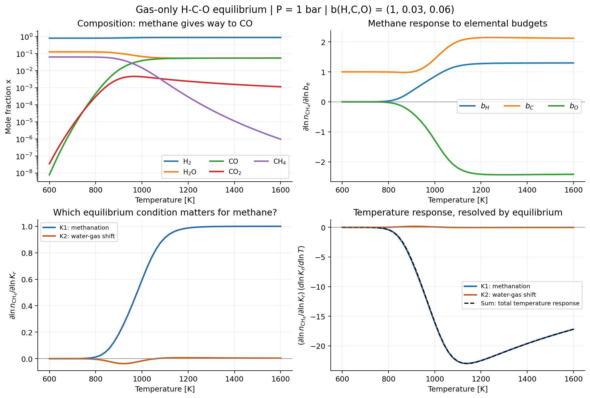
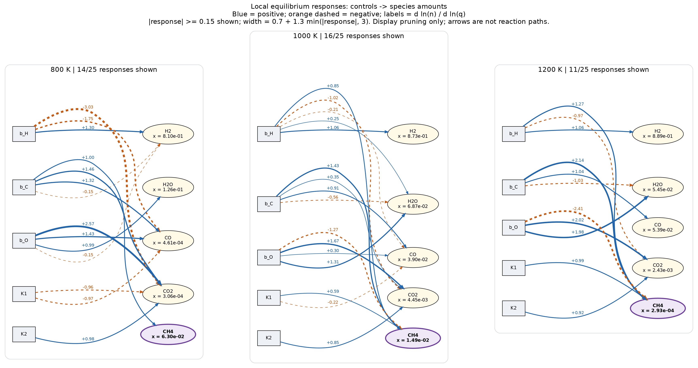
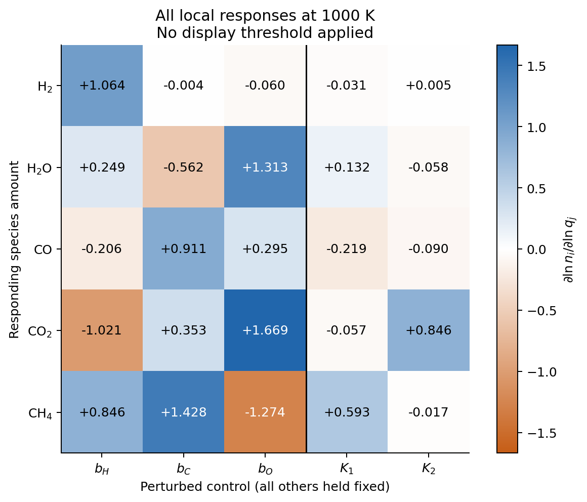

Understanding gas equilibrium through local responses
=====================================================

The five-species example ``examples/equilibrium_sensitivity.py`` asks a simple
question: **which inputs matter for methane at this equilibrium state?**
It uses the existing differentiable gas solver, NetworkX and Graphviz.
There is no new solver or library API.

Start with H2, H2O, CO, CO2 and CH4 at 1 bar, with elemental amounts
``b(H,C,O) = (1, 0.03, 0.06)`` in a common arbitrary amount unit.
This deliberately enriched, hydrogen-dominated teaching mixture makes CO2
visible. It is not a solar composition or a complete atmosphere model.
The temperature scan covers 600--1600 K with ideal gases and no condensation.
Thermochemistry comes from the packaged ``fastchem4`` subset; the reviewed
``curated`` preset has a 1500--4000 K domain and cannot cover this scan.

.. math::

   \mathrm{CO}+3\mathrm{H_2}\rightleftharpoons\mathrm{CH_4}+\mathrm{H_2O}
   \qquad (K_1),

   \mathrm{CO}+\mathrm{H_2O}\rightleftharpoons\mathrm{CO_2}+\mathrm{H_2}
   \qquad (K_2).

These two independent reactions span the allowed composition changes for
five species under three independent elemental constraints. Their constants
use dimensionless activities :math:`x_i P/P^\circ`, with :math:`P^\circ=1` bar.

What a sensitivity means
-------------------------

Inspired by Metabolic Control Analysis, define dimensionless local responses

.. math::

   C_{ie}=\left.\frac{\partial\ln n_i}{\partial\ln b_e}\right|_{T,P,b_{f\ne e},K},
   \qquad
   R_{ir}=\left.\frac{\partial\ln n_i}{\partial\ln K_r}\right|_{T,P,b,K_{s\ne r}}.

A coefficient of +1.43 means that a small 1% increase in that input produces
approximately a 1.43% increase in the species amount. A negative coefficient
means a decrease. The coefficients describe the total response after all
species re-equilibrate. They are not reaction rates, flux-control coefficients,
or a decomposition into causal paths through intermediate molecules.

Elemental inputs are independent and **not renormalized**. Increasing C with
H and O fixed also increases C/O; changing C/O by removing O is a different
perturbation. Here :math:`n_i` denotes an amount, not a number density or mole
fraction. The overview shows mole fractions for readability, but all response
plots use amounts. If mole-fraction responses are wanted, subtract
:math:`\sum_j x_j C_{je}` from each column (and analogously for :math:`R`).

Let :math:`A` be the element matrix and :math:`S` the species-by-reaction
matrix (products minus reactants). For dimensionless standard potentials
:math:`h=\mu^\circ/(RT)`, :math:`\ln K=-S^T h`.
The example perturbs the complete reaction basis using

.. math::

   b'=b\odot\exp(\theta_b), \qquad
   h'=h-S(S^T S)^{-1}\theta_K.

Thus :math:`\ln K'=\ln K+\theta_K`. ``jax.jacrev`` of the solver's
``result.ln_n`` returns :math:`[C\ R]` at zero perturbation, using the existing
implicit JVP. No iteration history is differentiated. Adding :math:`A^T\lambda`
to :math:`h` changes the elemental energy reference but leaves equilibrium and
its responses unchanged. Reaction responses do depend on the chosen reaction
basis, its orientation and normalization; this basis is kept fixed throughout.

Reading the figures
-------------------

   Methane is carbon limited at low temperature. Near 1000 K, oxygen competition
   and the methanation equilibrium become important. The lower-right panel
   resolves the temperature response into the two equilibrium conditions.

At 800 K, :math:`C_{\mathrm{CH_4},C}=0.995`: nearly all carbon is already
in methane. At 1000 K the C and O responses are +1.428 and -1.274;
the :math:`K_1` and :math:`K_2` responses are +0.593 and -0.017.
At 1200 K the O response reaches -2.415 and the :math:`K_1` response +0.988.
These are calculated local coefficients for this restricted model.

   Boxes are controls; ellipses are responding species. Blue solid arrows
   indicate positive responses and orange dashed arrows negative responses.
   Labels give coefficients; widths follow their absolute values, capped at 3.
   Only coefficients with magnitude at least 0.15 are drawn. All species and
   controls remain visible; pruning affects the display, not the solved model.

The water-gas-shift control :math:`K_2` matters for CO2 but has a weak local
effect on CH4. This is the useful simplification: importance depends on the
target species and the state. A missing edge means ``below the display
threshold``, not zero coupling. Node labels show mole fractions so that a
large fractional response of a trace species is not mistaken for a large
absolute redistribution. This graph does not justify deleting reactions or
species from future solves, nor does it estimate uncertainty without input
uncertainties and their correlations.

   The complete response matrix retains the weak edges and their signs.

At fixed pressure and elemental amounts, the thermal decomposition is

.. math::

   \frac{d\ln n_i}{d\ln T}
   =\sum_r R_{ir}\frac{d\ln K_r}{d\ln T}.

The example checks this against direct differentiation of temperature at all
51 sampled states. At fixed temperature the pressure response is
:math:`-R\,\Delta\nu=2R_{:,1}` for this basis, since
:math:`\Delta\nu=(-2,0)`. These decompositions isolate the selected
equilibrium conditions, not unique molecular pathways.

Reproduce and check
-------------------

With ExoGibbs, Matplotlib, NetworkX and Graphviz's ``dot`` available, run offline::

   JAX_ENABLE_X64=1 JAX_PLATFORMS=cpu MPLBACKEND=Agg \
     python examples/equilibrium_sensitivity.py
   pytest tests/unittests/examples/equilibrium_sensitivity_test.py

Outputs go to ``results/equilibrium_sensitivity/``: PNG/PDF figures, the network
in SVG/DOT, complete coefficients in ``response_matrices.csv``, and numerical
checks and input definitions in ``validation.json``. Species/control indices
in the CSV follow the orders recorded in the JSON. Re-running regenerates them.

The example checks convergence before interpreting any solution. At the three
network states it compares AD against central log-parameter differences with
step :math:`10^{-4}` and an independently assembled linear response system:

.. math::

   \begin{pmatrix}
   D_b^{-1} A D_n\\
   S^T(I-\mathbf{1}x^T)
   \end{pmatrix}
   [C\ R]=I_5.

The first block is differentiated elemental conservation; the second is
differentiated mass action. Tests also verify energy-reference invariance,
:math:`C\mathbf{1}=\mathbf{1}` for common amount scaling, and the pressure
identity above. A dilute comparison with :math:`b=(1,2.7\,10^{-4},4.9\,10^{-4})`
at 1200 K retains a much weaker water-gas-shift response of methane.

This small system establishes the interpretation before moving to H-C-O-N
and HCN: add independent equilibria, retain the same conservation checks,
and compare target-specific responses before choosing a display threshold.
