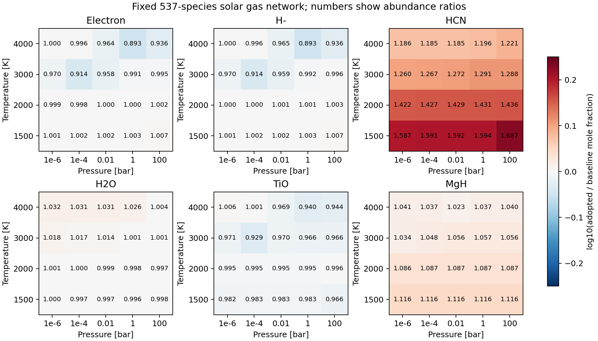

Gas thermochemistry: fixed-network abundance impact
===================================================

This study applies the approved :doc:`atomic_ion_adoption` and
:doc:`major_molecule_adoption` choices to **one fixed 537-species gas network**.
The largest sampled changes in the principal diagnostics are about **-10.7%
for electrons and H-**, **+68.7% for HCN**, and **-7.1% for TiO**.
The changes are source sensitivities, not estimates of physical errors.
The implementation remains a research example; no production preset or
ExoGibbs runtime dependency on MCEG is introduced.

Controlled comparison
---------------------

* Start with the ion-inclusive ``FastChem4/logK/logK.dat`` network of 539
  species and remove N- and Zn- from **every** model, following the approved
  bound-state policy. This isolates thermochemical changes from species-set
  changes; it does not measure the separate effect of those two exclusions.
* Read the packaged ``FastChem4/element_abundances/asplund_2021.dat`` explicitly.
  The same 27-element, sum-normalized nuclear budget and zero charge budget
  are used throughout. C/O is **0.5888436554**. The file's Ge abundance is used,
  avoiding its known difference from the preset's built-in reference vector.
* Evaluate **1500, 2000, 3000 and 4000 K**, each at **1e-6, 1e-4, 0.01, 1 and
  100 bar**. These four temperatures are shared reviewed nodes of the atomic
  and molecular choices, including TiH's narrower review window. No
  interpolation, extrapolation or silent fallback is performed.
* Use ideal-gas equilibrium at standard pressure 1 bar, with no condensates,
  rainout, external ionization, nonideal corrections or isotopologue resolution.
  Numerical evaluation at a point does not establish atmospheric applicability.

.. list-table:: Models, all with identical species order, stoichiometry and budget
   :header-rows: 1
   :widths: 22 78

   * - Model
     - Thermochemistry
   * - ``baseline``
     - Original FastChem coefficients on the shared restricted network.
   * - ``atoms_only``
     - Replace 47 bound atomic-ion constants: 43 threshold-updated NASA curves
       and four adopted partition models. Keep baseline molecules.
   * - ``molecules_only``
     - Apply all 35 molecular decisions; 23 change numerical constants and
       12 retain the original fits. Keep baseline ions.
   * - ``adopted``
     - Combine the approved atomic and molecular choices.
   * - ``atomic_reference``
     - Keep adopted molecules and substitute all 47 audited atomic partition
       references. This probes the remaining ionic thermal differences.
       Thresholds and four partition choices are shared with the adopted model;
       it is not an independent validation of the complete network.

There are **100 ExoGibbs equilibrium calculations**, with cold initialization
at every point. Each model uses the same neutral-atom/electron zero gauge,
:math:`h_i=-\ln K_{p,i}`. The electron stoichiometric coefficient is -1 for a
singly positive ion and +1 for a singly negative ion. This preserves the
pressure powers in ionization and attachment reactions.

The factorial interaction recorded in the detailed table is

.. math::

   I_i=\log_{10}x_{i,\mathrm{adopted}}
       -\log_{10}x_{i,\mathrm{atoms}}
       -\log_{10}x_{i,\mathrm{molecules}}
       +\log_{10}x_{i,\mathrm{baseline}}.

This separates the two source changes without assuming that composition
responds linearly or that elemental conservation leaves atomic abundances fixed.

Abundance results
-----------------

Here :math:`x_i=n_i/\sum_j n_j` is the gas mole fraction, including electrons.
Each row shows the largest absolute logarithmic change among points where
**both** compared mole fractions exceed :math:`10^{-12}`. This reporting
threshold is not an abundance floor: all 537 log amounts are retained in the
archive, and the full summary also gives extrema over all 20 points.

.. csv-table:: Selected abundance changes
   :header: Species, T (K), P (bar), Baseline x, Adopted x, Adopted / baseline
   :widths: 12, 10, 10, 22, 22, 24

   e-,4000,1,7.79235e-6,6.96092e-6,0.89330
   H-,4000,1,3.66023e-8,3.27026e-8,0.89346
   H2,2000,1e-6,0.193393,0.193068,0.99832
   H2O,4000,0.01,7.81894e-9,8.06296e-9,1.03121
   CO,1500,100,1.34290e-5,1.41453e-5,1.05334
   CO2,1500,100,4.64172e-9,4.86273e-9,1.04761
   CH4,1500,0.01,4.65932e-10,4.42230e-10,0.94913
   N2,4000,1e-6,1.24086e-9,1.22136e-9,0.98428
   NH3,4000,100,1.94194e-6,1.82509e-6,0.93983
   HCN,1500,100,1.63825e-8,2.76443e-8,1.68743
   H2S,2000,1e-6,5.17815e-10,5.94839e-10,1.14875
   SH,2000,1e-6,1.14169e-7,1.27206e-7,1.11419
   S2,1500,1e-6,1.52900e-7,2.11160e-7,1.38103
   TiO,3000,1e-4,1.32586e-10,1.23125e-10,0.92864
   VO,3000,1e-4,1.38499e-12,1.34575e-12,0.97167
   SiO,3000,1e-6,7.27494e-8,7.76912e-8,1.06793
   CaH,4000,1,3.80445e-9,3.48006e-9,0.91474
   MgH,1500,0.01,2.18669e-10,2.44111e-10,1.11635
   FeH,4000,0.01,3.06548e-10,3.11450e-10,1.01599
   NiH,4000,0.01,1.38440e-12,5.61059e-11,40.5272
   CuH,4000,1,1.27934e-11,1.68356e-10,13.1596

The figure includes trace-abundance points; use the accompanying absolute
mole fractions before interpreting a ratio as important for opacity.
No radiative-transfer or opacity-weighted calculation was performed.

Why equilibrium constants and abundances differ
------------------------------------------------

**Electrons and H-.** At 4000 K and 1 bar, Ni+ falls from
1.16023e-6 to 1.29931e-8 in mole fraction. Other positive ions partly compensate,
leaving the total electron mole fraction 10.67% lower. The ``atoms_only``
electron ratio is 0.89338; the ``molecules_only`` ratio is 0.99993.
H-'s own attachment constant changes by only about **+0.0215%** at 4000 K.
Its abundance follows the electron supply through
:math:`x_{\mathrm{H^-}}=K_p x_{\mathrm{H}}x_e P/p^\circ`, explaining its
similar 10.65% decrease. Ni+ formation constants fall by 2.21--2.47 dex across
the four temperatures; Cu+ changes by about -3.22 dex. Neither change can be
read directly as a change in the total electron abundance.

**HCN and sulfur.** HCN's formation constant increases by 0.1970 dex at
1500 K (a factor 1.574), while its abundance at 100 bar increases by 1.687.
The additional response comes from the coupled C/H/N molecular equilibrium.
The atomic-only change there is negligible. H2S, SH and S2 show appreciable
changes despite fixed elemental sulfur. The larger formal CS2 ratio occurs
at trace abundance; its full range and absolute amounts remain in the CSV.

**Metal oxides and hydrides.** At 3000 K and 1e-4 bar, TiO's atomic-only and
molecular-only ratios are 0.96181 and 0.96552; the combined ratio is 0.92864.
VO's own formation constant increases, yet its abundance falls because the
available neutral V changes. NiH and CuH retain their molecular constants but
increase as neutral metal becomes available after the ionization corrections.
Their unrestricted maximum ratios reach roughly 293 and 1653 at much smaller
absolute abundances; those extrema must not be mistaken for equally large
opacity effects. Even retained thermochemistry can therefore produce a
substantial abundance change in the coupled network.

Numerical verification versus physical evidence
-----------------------------------------------

**ExoGibbs verification.** All 100 cases converge with the explicitly selected
``epsilon_crit=1e-13`` in CPU float64. Maximum relative nuclear-budget and
charge residuals are **1.82e-6** and **2.13e-6**, respectively; the maximum
absolute natural-log mass-action residual over every species is **1.43e-12**.
The independent acceptance gates are 1e-5 for both relative budgets and 1e-8
for mass action. Charge error is normalized by the total absolute charge
carried by species, not by the zero net-charge target or total gas abundance.

This extra check is necessary: the preliminary default-tolerance run reported
convergence at 1500 K and 100 bar despite relative charge errors of about
71% (baseline) and 80% (adopted). Those preliminary amounts are not the
reported results. The study tightens its own options and preserves runtime
defaults; a convergence flag alone is insufficient evidence for trace electrons.

**FastChem verification.** The optional standalone adapter exports the same
537-species catalog and the evaluated ln K at each individual temperature,
then compares independently initialized FastChem 4 and ExoGibbs solutions.
It uses constant fit coefficients solely as a transport format for that one
temperature; those files are not continuous thermochemical fits. No FastChem
output is supplied to ExoGibbs. Electron and H- agreement and species above
1e-12 are checked against 1e-3 dex, with relative charge/element gates as well.
The standalone **FastChem v4.0.3** run passed at **all 100 conditions**. Its
unmodified source is pinned to commit
``ae67cbd559bc64a3233a1cee6030b8e6b50520de``; the compiler, build command,
executable hash and equality of the upstream/packaged input files are recorded.

.. list-table:: Maximum ExoGibbs--FastChem differences over all five models
   :header-rows: 1
   :widths: 65 35

   * - Quantity
     - Maximum absolute difference
   * - Mole fraction, species above 1e-12 in either solver
     - 9.46e-7 dex (about 0.000218%)
   * - Electron mole fraction, every point
     - 9.01e-7 dex (about 0.000207%)
   * - H- mole fraction, every point
     - 9.01e-7 dex (about 0.000207%)
   * - Mole fraction, all 537 species including traces
     - 7.89e-6 dex
   * - Total gas amount per nuclear budget
     - 4.89e-11 relative

The largest difference above the reporting threshold is K+ in the baseline
at 1500 K and 1 bar. FastChem's maximum relative elemental and charge
residuals are 5.75e-11 and 2.75e-11; its largest mass-action residual is
5.74e-10 in natural-log units, including output rounding. The original
ExoGibbs abundance, source-comparison, diagnostic and plot files remain
byte-identical to the preceding run. These results verify the independent
equilibrium implementations; they do not establish physical accuracy.

**Physical evidence.** The atomic reference uses spectroscopy and level-based
partitions from the preceding audit, independently of FastChem's fitted
constants. For the 43 NASA-based choices, the maximum constant discrepancy
at these four nodes drops from about 3.222 dex (Cu+) to **0.00479 dex** (Fe-).
Replacing all ionic constants by the reference changes the adopted electron
and H- abundances by at most **0.0214%** and **0.1016%**. This supports the
remaining atomic thermal choices on this sampled grid. It does not test
shared threshold errors, the four references adopted by construction,
high-state density effects, or the complete molecular network.

The molecular CSV retains BC source comparisons, including a counterfactual
with BC's dissociation energy replaced by the adopted energy. This separates
energy and thermal discrepancies. It explicitly marks retained BC fits as
source-reproduction checks. TiO still differs from energy-matched BC by up to
**0.090 dex**; CaH's unadjusted discrepancy reaches **1.988 dex**, and TiH's
reaches **0.523 dex**. These disagreements and the unresolved CH4/FeH thermal
or energy questions remain open. Agreement with FastChem cannot resolve them.
There is no independent whole-mixture measurement in this study, so the
physical-accuracy claim for the complete hybrid remains **unknown** in MCEG.

Artifacts and reproduction
--------------------------

* :download:`Per-species summary <../tests/data/validation/gas_thermochemistry_impact/species_summary.csv>`
  and :download:`all reported mole fractions and source effects
  <../tests/data/validation/gas_thermochemistry_impact/abundances.csv>`.
* :download:`328 equilibrium-constant comparisons
  <../tests/data/validation/gas_thermochemistry_impact/equilibrium_constants.csv>` and
  :download:`100 solver diagnostics <../tests/data/validation/gas_thermochemistry_impact/diagnostics.csv>`.
* :download:`All-species log amounts, thermochemistry, budgets and catalogs
  <../tests/data/validation/gas_thermochemistry_impact/equilibria.npz>` and
  :download:`run receipt <../tests/data/validation/gas_thermochemistry_impact/receipt.json>`.
  The NPZ axes are model, temperature-major/pressure-minor point, and species;
  h has separate model, temperature and species axes. ``fastchem_ln_n`` uses
  the same ordering and nuclear-budget normalization as ``ln_n``.
* :download:`100 independent FastChem comparisons
  <../tests/data/validation/gas_thermochemistry_impact/fastchem_parity.csv>` and
  :download:`source and build provenance
  <../tests/data/validation/gas_thermochemistry_impact/fastchem_build.json>`.
* :download:`MCEG contract <../mceg/contracts/gas_thermochemistry_impact.yaml>`
  and :download:`test receipt <../tests/data/validation/gas_thermochemistry_impact/tests.json>`.

Run the offline study into a separate directory to preserve the recorded
standalone comparison:

.. code-block:: bash

   .venv/bin/python examples/comparisons/compare_gas_thermochemistry.py \
     --output-dir /tmp/exogibbs_gas_impact_offline

To include an independently built FastChem 4 executable:

.. code-block:: bash

   OMP_NUM_THREADS=5 .venv/bin/python examples/comparisons/compare_gas_thermochemistry.py \
     --fastchem-executable /tmp/exogibbs_fastchem4 \
     --fastchem-version-label "4.0.3 (ae67cbd)"

The build record supplies the exact clone and compiler commands. Source and
executable are temporary external comparison tools, not packaged dependencies.
The executable is optional for reproduction of the source-impact calculation;
its absence is recorded explicitly as ``not_run`` with an empty FastChem array.
The recorded comparison includes both solvers. Tests verify the archived
independent solutions offline and do not import MCEG or require a FastChem
installation. Contracts can be validated separately
with the development MCEG checkout. References and their inspection limits
are preserved in the preceding two adoption reports and their pinned fixtures.
