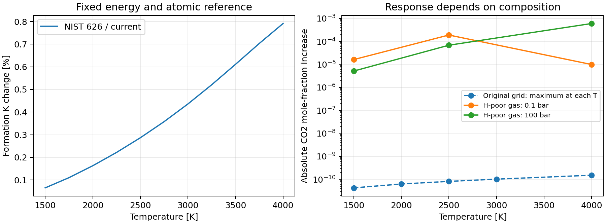

CO2 NIST candidate and finite substitution
==========================================

The 2026-11-04 extension to PR #329 constructs the bounded candidate proposed
in :doc:`co2_source_review` and measures its equilibrium response. **The NIST
626 candidate is the preferred modern thermal model within its stated
representative-isotope approximation.** Its numerical representation and
finite replacement are verified. The comparison supports a separately
reviewed scoped adoption; production remains ``curated-tio-v1`` here.
Complete natural-isotope chemistry and atmospheric physical accuracy remain
unknown. The original source assessment and its hashed artifacts are retained
unchanged as historical evidence.

Model and energy reference
---------------------------

The primary model uses the 12C16O2 (626) tables in the NIST dataset
`10.18434/mds2-2364 <https://doi.org/10.18434/mds2-2364>`_, published in 2021
and described by Tashkun and Harvey (2025),
`10.1063/5.0276615 <https://doi.org/10.1063/5.0276615>`_. The already inspected
full text and all 12 isotope tables are sufficient for this candidate.
The source review records the printed heat-capacity equation's sign error
and the independent Q/H/S/Cp identities showing that the numerical tables
use the correct variance relation. Those table values are preserved.

The elemental approximation has these explicit choices:

* Internal functions represent 626, relative to its lowest rovibrational
  level. The nuclear-spin product is one. Allowed states already encode
  oxygen-exchange symmetry; no extra symmetry division or ZPE is added.
* Molecular translation uses the existing NASA elemental mass 44.0095 u,
  current SI constants and standard pressure 1 bar. This changes neither
  isotope energy levels nor the atomic reference.
* Atom-balanced ATcT 1.172 energy remains 1598.180 kJ/mol for
  C(g) + 2 O(g) -> CO2(g). Existing NASA C/O thermal functions, including
  their historical dimensionless R convention, are retained. The
  molecule's dissociation cutoff is not substituted for total atomization.
* NIST's internal Q/H/Cp retain its CODATA 2014 c2 = 1.43877736 K cm.
  Dimensionless calorics are expressed with common modern R. Translation
  is reconstructed, so old kB/h/mass-unit conventions are not silently
  imported through the published entropy. Rescaling internal c2 would
  change ln Q by only about 1.1-1.4e-6 here; that known sensitivity is
  recorded, without claiming an exact Hamiltonian recalculation.
* Evaluation is restricted to 1500-4000 K, with no external extrapolation.

With ``qtr=(2*pi*m*kB*T/h**2)**1.5`` and ``H*=H/(RT)`` from the ground-zero
source table, the molecular functions are

.. math::

   G_{\rm rel}/R=-T\ln[Q\,q_{\rm tr}k_BT/p^\circ],\qquad
   H_{\rm rel}/R=T H^*,\qquad S/R=(H_{\rm rel}-G_{\rm rel})/(RT).

Only CO2's formation potential changes. All other species functions and
elemental budgets are held fixed in every finite comparison.

Derivative consistency and fit precision
-----------------------------------------

Eleven knots at 250 K spacing define a C2 quintic representation of
``(G-H0)/R`` using source G, -S and -Cp/T as endpoint value, slope and
curvature. H, S and Cp are derivatives of this single function, rather
than independently interpolated curves. The entire polynomial interval
is checked for positive heat capacity, including its interior extrema.

At 90 withheld integer temperatures the maximum errors are 2.374e-8 in
ln K, 0.00739 J/mol in H, 4.38e-6 J/mol/K in S and 0.000200 J/mol/K in Cp.
An independent comparison against all 2501 official 626 rows on 1500-4000 K
finds maxima 2.377e-8, 0.00758 J/mol, 4.46e-6 J/mol/K and 0.000200 J/mol/K,
respectively. The complete-table check is acquisition-time evidence; the
compact offline packet retains the independent source nodes and moments.
JAX derivatives, endpoint joins and scalar/batch evaluations agree with the
same model. Fit error is smaller than source uncertainty and is not a
physical accuracy claim.

The candidate/current formation-K ratio rises from 1.000651475 at 1500 K
to 1.007912883 at 4000 K. Existing energy and atomic thermal functions
cancel in these ratios. A K multiplier is not generally an abundance
multiplier, as the finite examples below demonstrate.

Why the main model uses 626
---------------------------

A second continuous model quantifies a fixed terrestrial-isotope thermal
sensitivity. For each of the 12 isotopologues, remove its overall nuclear-spin
product from Q, preserve state-dependent weights and exchange symmetry,
and reconstruct translation at the common mass. Average G, H, S and Cp
with the published fixed isotope fractions. Its effective Q is the
geometric mean ``exp(sum(x_i*ln(Q_i/g_ns_i)))``, not ``sum(x_i*Q_i)``.
Each component retains its own rovibrational ground zero.

This thermal diagnostic raises K by 0.4278-0.4563% relative to the primary
626 candidate. It is deliberately **not** called a complete natural-isotope
formation constant: isotope-specific D0, elemental isotope balance and
fractionation have not been built. A molecular mixing entropy cannot be
added without the corresponding atomic mixing entropy. For the same random
fixed isotope fractions, their difference is

.. math::

   [S_{\rm mix}(CO_2)-S_{\rm mix}(C)-2S_{\rm mix}(O)]/R
      =-p_{\rm hetero\ O}\ln 2=-0.0033615893.

Here ``p_hetero O = 0.0048497482``. This cancels much of the exchange-symmetry
entropy difference: including only this known reference-convention term
would leave a ratio of roughly 1.00091-1.00119. That illustration still
omits isotope atomization shifts and fractionation, and is not adopted as
a natural model. No ZPE correction is appended to the fixed common ATcT
anchor. The raw 0.46% diagnostic is therefore neither a physical isotope
correction nor an upper error bound.

Using 626 is a clear, reproducible elemental approximation, proportionate
to this bounded investigation. Exact natural-isotope chemistry is a distinct
precision requirement. The sensitivity is retained visibly rather than
claiming that the source's parameter uncertainty covers isotope conventions.

Finite equilibrium replacement
--------------------------------

The saved ``curated-tio-v1`` baseline supplies 75 converged ion-inclusive
cases and the complete 537-species inventory, stoichiometric matrix and
budgets. Every original potential is checked before reuse. The candidate
adds 75 cold solves on that identical grid.

Because CO2 is a trace constituent in that hot hydrogen-rich grid, six
additional controlled cases use C/O=0.5, H/O=0.01 and He/O=0.001, retaining
every other heavy-element/O ratio from the preset. The full catalog is
unchanged. Both current and candidate models are cold-solved at 1500,
2500 and 4000 K, each at 0.1 and 100 bar: 12 additional endpoints.
This idealized hydrogen-poor oxidized gas tests a different composition;
it is not a reconstruction or validation of a particular planet.

All **87 new endpoints** converge. The original-grid CO2 mole-fraction
ratio is 1.00065124-1.00791288, close to the K ratio because CO2 remains
trace. Its largest absolute change is only 1.50482e-10 at 4000 K, 100 bar
and reference C/O, from 1.9019267e-8 to 1.9169749e-8. CO supplies most
of the balancing carbon response there.

.. list-table:: Hydrogen-poor gas: actual CO2 mole-fraction response
   :header-rows: 1

   * - T, K
     - P, bar
     - Current x(CO2)
     - Candidate x(CO2)
     - Candidate/current abundance
   * - 1500
     - 0.1
     - 0.370786
     - 0.370802
     - 1.00004367
   * - 1500
     - 100
     - 0.402006
     - 0.402011
     - 1.00001275
   * - 2500
     - 0.1
     - 0.260990
     - 0.261180
     - 1.00072608
   * - 2500
     - 100
     - 0.323175
     - 0.323243
     - 1.00021129
   * - 4000
     - 0.1
     - 0.00125538
     - 0.00126525
     - 1.00786871
   * - 4000
     - 100
     - 0.134521715
     - 0.135121957
     - 1.00446205

At 4000 K and 100 bar, the K change of +0.7913% produces an abundance
change of +0.4462%, or +0.000600242 in mole fraction. Carbon in CO2 rises
from 31.4003% to 31.5313%: +0.13103 percentage points. This is a measurable
finite response under the specified gas model, despite its small absolute
impact in the original hydrogen-rich grid.

   Frozen results, reproduced by ``mceg/reviews/plot_co2_candidate.py``.
   Lines connect sampled conditions. The right panel compares absolute
   abundance changes in different prescribed compositions, not physical
   uncertainty bands or predicted observations.

Stability, uncertainty and remaining limits
--------------------------------------------

Eight tighter endpoint solves separately check the target molecule and
all species. On the original grid the maximum all-species difference is
2.54e-5 in ln mole fraction, located in trace F10S2; CO2 differs by less
than 1.25e-13. On the hydrogen-poor highlighted case the maximum is below
1.78e-13 across all species. These numerical trace-species differences
are not interpreted as a CO2 source response. Native C/O conservation
residuals are below 2.34e-13 in the original grid and 4.73e-14 in the
hydrogen-poor cases. The largest elemental residual, 2.54e-6, is for trace
fluorine. Charge closure is below 7.22e-14 and mass-action residuals below
1.37e-12. Same-model Gibbs ordering is checked after removing first-order
element-budget residual contributions; different physical models are
never ranked by comparing their absolute Gibbs values.

A five-point finite path at the highlighted hydrogen-poor case increases
the CO2 amount monotonically. Independent FastChem calculations for both
models at that case agree for all 537 species within 2.30e-9 dex, with
charge and mass-action checks. These are numerical checks, not experiments.

Nine local solves compare the isotope diagnostic and Q shifted by plus or
minus one published standard uncertainty at the original-grid highlight,
and hydrogen-poor 1500/4000 K, 100 bar cases. At hydrogen-poor 4000 K,
100 bar, the standard-Q perturbation gives x(CO2)=0.135045284-0.135198568,
versus 0.135121957 centrally: about +/-0.0567%, smaller than the +0.4462%
current-to-candidate response. The fixed-isotope thermal diagnostic changes
that abundance by +0.2569% relative to the primary candidate. It is a
reference-convention sensitivity, not a physical correction or confidence
interval. No correlated ATcT energy uncertainty or full source-error band
is inferred from these local Q perturbations.

NIST parameter covariance does not bound all high-state, continuum,
electronic-state or dissociation-cutoff errors. In particular, the source's
warning about non-dissociating pure CO2 above about 3500 K remains relevant.
This equilibrium network includes CO and O, so bound-species thermodynamics
and the heat capacity of a reacting bulk gas are distinct. The 3500-4000 K
candidate is a specified ground-electronic bound-species model, not a
claim that the original nonreacting table models bulk dissociation. No
continuum term is invented or appended. The original UCL distributed
PF/Cp cutoff issue also remains documented; those files are not used to
construct the NIST candidate.

The scientific preference rests on the modern thermodynamic construction,
explicit conventions, verified derivatives and finite response. Additional
historical-paper collection is not needed to review this completed model.
A production adoption would retain these declared limits and versioned
reproducibility. Demands for sub-per-mille natural-isotope accuracy or
continuum thermochemistry require a correspondingly broader model.

Artifacts and MCEG
-------------------

``mceg/reviews/co2_candidate.py`` evaluates the frozen candidate offline;
its extraction option reads the previously pinned official tables.
``mceg/reviews/co2_equilibrium_impact.py`` reproduces the actual calculations.
Candidate and execution packets are stored under
``tests/data/validation/co2_candidate/20261104`` and
``tests/data/validation/co2_equilibrium_impact/20261104``. Full logarithmic
amounts, potentials, budgets and diagnostics are retained without a trace
abundance floor. The optional independent check requires the hashed
FastChem executable; offline tests need neither that binary nor MCEG.

The existing CO2 contract adds a new candidate/finite-response subject
and assessments, preserves its earlier source judgments, and records the
bounded-candidate follow-up as completed within the stated isotope scope.
Complete physical accuracy remains unknown. Production adoption and any
higher-precision isotope model are explicit subsequent decisions.
