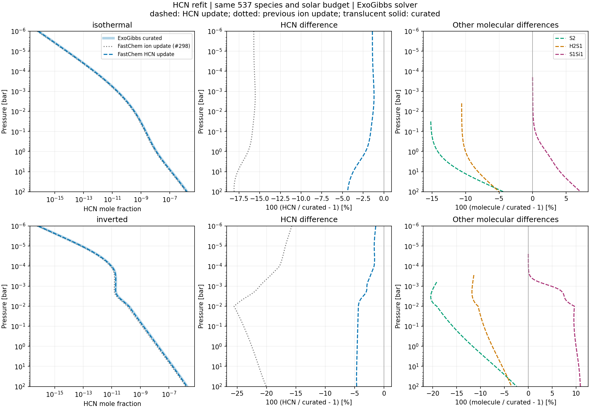

HCN follow-up: tracking a thermochemical database difference
============================================================

This investigation continues `PR #298
<https://github.com/HajimeKawahara/exogibbs/pull/298>`_ using the revised tables
provided in `Daniel Kitzmann's follow-up
<https://github.com/NewStrangeWorlds/FastChem/issues/10#issuecomment-6439534232>`_.
It compares those inputs with the earlier preliminary tables and the current
ExoGibbs default. The production preset is unchanged. Spectra and metallicity
retrieval remain outside this investigation.

What constitutes a new result?
------------------------------

The standard and extended files change HCN coefficients relative to the earlier
preliminary inputs. The Hoeijmakers file also changes its HCN identifier from
``C1H1N1_1`` to ``C1H1N1_hcn``. Matching only raw identifiers would therefore
mistake a renamed molecule for a removed and an added species. The audit must
preserve both identifiers and confirm the molecular identity and composition
before comparing coefficients.

Daniel reports a refit using Goos and Burcat data and questions the older HCN
thermochemical inputs. This is evidence of the producer's diagnosis and intended
change. Reading the comment does not independently reconstruct the historical
measurements, heat capacities, source polynomial or fitting procedure. The
archive audit and the equilibrium comparison supply separate, reproducible
evidence about the supplied coefficients and their numerical consequences.

The :download:`source audit <../../mceg/reviews/fastchem_hcn_sources_20261028.json>`
finds HCN Hf(298 K) = 129.799 kJ/mol in a public Burcat entry, versus
129.293 kJ/mol in curated's ATcT reference. This version difference is a
candidate explanation for part of the residual; the producer's exact input
snapshot and fitting recipe remain unidentified.

The :download:`comparison summary
<../../tests/data/validation/new_fastchem_hcn/summary.json>` records the measured
results. The supplied :download:`archive
<../../tests/data/validation/new_fastchem_hcn/logK_hcn.zip>` identifies the new
input bytes. The comparison procedure is
``mceg/reviews/fastchem_hcn_20261028.py``; generated figures and full run outputs
belong under ``results/new_fastchem_hcn/``. Earlier #298 evidence remains an
assessment of its original inputs.

Measured changes
----------------

All 966 layer/model cases pass the existing element, charge and mass-action
gates. The largest absolute logarithmic HCN factorization residual is
``1.81e-13``. These are numerical checks on the prescribed columns, not an
independent physical validation.

.. list-table:: Largest HCN deviations from curated on each sampled profile
   :header-rows: 1

   * - Profile
     - Previous preliminary table
     - Revised HCN table
   * - 4000 K isotherm
     - -18.09% at 70.79 bar
     - -4.38% at 100 bar
   * - 2500--4000 K inversion
     - -25.55% at 2500 K, 0.01 bar
     - -4.67% at 3400 K, 39.81 bar

Extrema include only states where either compared mole fraction reaches
``1e-12``; the locations of the old and new extrema need not coincide.
At 2500 K and 0.01 bar, the revised/default HCN ratio is
``0.96736321 * 0.98874011 = 0.95647080``, versus ``0.74452720`` previously.
The revised/previous abundance ratio is ``1.28466871``; its atomic-product
factor is ``0.99999962``, so the change at this sample is almost entirely the
HCN constant update. The remaining revised/default difference includes both
the HCN constant and coupled atomic abundances.

Other differences remain: the inverted-column extrema for S2, H2S and SiS
are approximately -20.43%, -11.80% and +10.90%, respectively. An HCN-only
coefficient update does not reconcile the other source choices.

An implementable MCEG workflow
------------------------------

The new :download:`v0.2 follow-up contract
<../../mceg/contracts/fastchem_hcn_followup.yaml>` separates propositions,
evaluated models, executions and judgments while preserving the earlier contract. Database investigations can use
these records without adding thermochemistry to MCEG itself:

.. list-table:: Records for this follow-up
   :header-rows: 1
   :widths: 22 78

   * - Record
     - Concrete use
   * - Subject
     - Identify the revised table, current default, normalization adapter and
       comparison implementation by revision and selected-file hashes. A
       coefficient change creates a new evaluated subject.
   * - Evidence
     - Keep the producer comment, archive/identifier audit, equilibrium-constant
       comparison and executed atmosphere checks as separate records. Numerical
       evidence includes input hashes, environment, result and artifact hashes.
   * - Context / Condition
     - Record the common species network, composition, pressure convention,
       solver settings and actual joint T/P samples. A pair of column profiles
       does not establish coverage of a rectangular T/P domain.
   * - Claim / Assessment
     - Assess the declared update scope, numerical closure and HCN attribution
       separately. Bind each assessment to the appropriate subject and context.
       Retain whole-mixture physical accuracy as unknown.
   * - FollowUp / FollowUpResolution
     - Give each unresolved question its required inputs and completion test.
       Link a completion to the evidence that answers that particular question;
       preserve the question and earlier evidence.

For example, identifying the changed HCN record can close an input-audit task;
reproducing its effect can close a numerical-comparison task. Neither completion
closes an independent-source validation task or authorizes adoption into the
default preset. The existing broad physical-validation and deferred retrieval
follow-ups should not be marked complete on the basis of this HCN update.

The old ``atomic_update_scope`` claim is explicitly about the earlier archive.
Its statement that only atomic ions changed must not be reused for the new
archive. Add a claim for the HCN update scope, or revise a proposition whose
meaning changes. A new execution with an unchanged proposition and tolerance
can reuse the claim revision, but needs its own evidence and assessment.

The :download:`follow-up contract <../../mceg/contracts/fastchem_hcn_followup.yaml>`
provides this minimal working example. An Issue supplies the discussion and
responsibility; MCEG supplies the subject, claim, evidence and completion
criteria. Closing an Issue or passing a check does not establish physical accuracy.

Checks that distinguish causes
------------------------------

Provider code performs scientific checks; MCEG records their criteria and results.

1. **Identity and conventions.** Check isomer, phase, composition and charge;
   retain any explicit alias mapping. Normalize formation versus dissociation,
   natural versus base-10 logarithms, dimensionless Kp and standard pressure.
   Distinguish 0 K atomization energy, formation enthalpy, zero-point energy and
   thermal functions. Compare within the stated temperature ranges.

2. **Thermochemical cause.** Compare equilibrium constants for balanced
   reactions, with consistent constituent-atom references. An elemental energy
   reference shift cancels from a balanced reaction and should not be diagnosed
   as a physical discrepancy. Holding thermal functions fixed isolates an energy
   anchor; holding the energy anchor fixed isolates thermal/fit differences.
   A constant energy shift contributes a term proportional to ``1/T`` in
   ``ln K``. This diagnostic alone does not establish the historical cause.

3. **Representation consistency.** If independent H, S and Cp data are supplied,
   compare them with the fitted free energy and its temperature derivatives,
   including interval boundaries. A fit generated from one common potential
   satisfies its own reaction-cycle identities by construction. Cycle closure
   becomes an independent source check only when compared with separately
   supplied reaction or thermochemical data.

4. **Equilibrium and attribution.** On the same network, budget and T/P samples,
   check element balance, charge balance and mass action. Decompose the molecular
   abundance ratio into its formation-constant ratio and constituent-atom
   product, as in #298. Check other species too: changing HCN can alter the
   coupled mixture even where their own coefficients are unchanged.

5. **Physical interpretation.** Agreement of the new HCN coefficients with
   curated is agreement between source choices, potentially with shared ancestry.
   It is not an independent measurement, a calibrated uncertainty distribution
   or a metallicity error. Source adoption remains a separate reviewed decision.

Reuse the reference handling in ``examples/comparisons/select_major_molecules.py``,
its tests in ``tests/unittests/examples/major_molecule_adoption_test.py``, and
the closure checks in ``examples/comparisons/demo_curated_atmosphere.py``.

What MCEG checks, and what remains a proposal
---------------------------------------------

``mceg check --assessment ID --root .`` checks structure, declared source traces
and selected-file/artifact hashes, then displays the stored support judgment.
It does not rerun chemistry or determine whether a dataset is physically better.
A changed hash detects an identity mismatch; it does not rewrite a previously
passed execution. New inputs require new evidence before support is assigned
to the new subject.

``provenance.derived_from`` represents actual source ancestry. Its
``consistent``/``discrepancy`` labels describe an inspected comparison along
that ancestry. Two alternative databases need not be ancestor and descendant;
their measured difference should be recorded as comparison evidence, not an
invented provenance edge. For a known shared source, record the dependency so
that agreement is not counted as two independent validations.

The current schema can retain failed numerical evidence and an assessment with
unknown support and an explicit reason. It has no general refuted-claim status,
automatic preferred-database selection, cross-contract impact propagation or
automatic selection of the latest valid assessment. These are possible later
extensions, not requirements for this investigation. A small provider report,
explicit evidence IDs, scoped follow-ups and selected assessments provide the
needed starting point.

Offline reproduction
--------------------

From the repository root, regenerate the comparison with the vendored inputs:

.. code-block:: bash

   OPENBLAS_NUM_THREADS=1 OMP_NUM_THREADS=1 JAX_PLATFORMS=cpu JAX_ENABLE_X64=1 \
     python mceg/reviews/fastchem_hcn_20261028.py
   python -m pytest -q tests/unittests/mceg_fastchem_hcn_test.py

With MCEG 0.2 available separately, inspect the scoped records:

.. code-block:: bash

   mceg check mceg/contracts/fastchem_hcn_followup.yaml \
     --assessment column_closure_and_hcn_factorization_review --root .
   mceg explain mceg/contracts/fastchem_hcn_followup.yaml \
     --assessment whole_mixture_accuracy_review --lang ja

The second assessment intentionally retains unknown physical support and an
incomplete producer-source trace. Completing the comparison does not close the
source reconstruction or physical-accuracy tasks.
