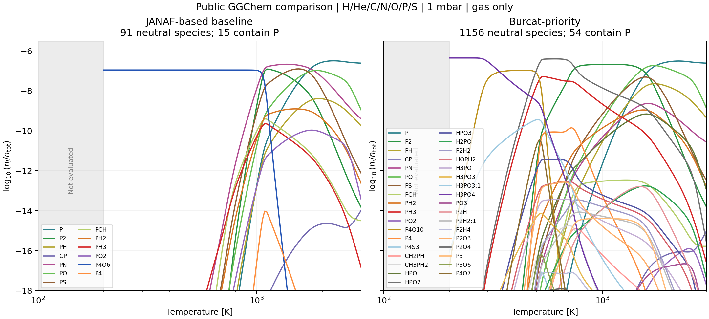

Phosphorus database comparison in Ohno's figure format
==========================================================

The public-source calculation now produces the two-panel comparison that
was missing from the earlier investigation. The JANAF-based selection
concentrates cold phosphorus in P4O6; prioritizing Burcat shifts it into
H3PO4, P4O10, HPO2 and PH3. Controlled calculations separate the effect of
the P4O6 function from the effect of including additional molecules.

These are new calculations with declared public inputs. Ohno's exact code
revision, source selection, elemental abundances and phase settings remain
unavailable, so neither curve-by-curve agreement nor an exact reconstruction
of the supplied slide is claimed.

Conditions and database selection
---------------------------------

The main comparison uses public GGChem commit
``65bbb8f9ca3d6c0b4e58cb7dd3862322452d0d4b``, 1 mbar, and 121 logarithmically
spaced temperatures from 200 to 3000 K. The selected elements are H, He, C,
N, O, P and S for the controls, and all 27 elements in the supplied Asplund
2021 file for the main comparison. The latter are H, He, Al, Ar, C, Ca, Cl,
Co, Cr, Cu, F, Fe, Ge, K, Mg, Mn, N, Na, Ne, Ni, O, P, S, Si, Ti, V and Zn.
Both use the same abundance values supplied through a custom file.
All selected gas records are retained under the native per-element
stoichiometric cap of 16. Ions, electrons, condensation and rainout are
excluded. With 27 elements, the two selections have 413 and 1740 neutral
species, respectively; 29 and 77 species contain P, including the P atom.
The seven-element controls have 91 and 1156 species, of which 15 and 54
contain P.

The labels describe the effective data priority, not pure single-source
databases. The JANAF-based baseline reads these files in order:

1. ``dispol_BarklemCollet.dat``
2. ``dispol_StockKitzmann_withoutTsuji.dat``
3. ``dispol_WoitkeRefit.dat``

The Burcat-priority selection adds ``dispol_BURCAT.dat`` last. Later files
replace earlier matching records. The baseline P4O6, P4O10, PH3 and PN
functions come from Woitke's NIST refits; the Burcat-priority selection
replaces them with Burcat records. GGChem also has an explicit same-formula,
different-name overwrite rule for the final Burcat file. The study exports
the final native selections rather than constructing an independent union.
The fixed upstream files and selection logic can be inspected in the
`pinned GGChem source <https://github.com/pw31/GGchem/tree/65bbb8f9ca3d6c0b4e58cb7dd3862322452d0d4b>`_.

Two unrelated organic labels in the Burcat output, NCCH2OH and C2H3O2, each
refer to two records with different elemental compositions. Both records
are retained with native-index suffixes and the original display names;
they are neither merged nor silently dropped. No P-bearing label has this
collision. Common-species comparisons require both the same exported name
and the same composition, and retain distinct isomers.

The plot matches the slide's conventions: logarithmic temperature and
log10 of the molecular number fraction, n_i/n_tot. The denominator is the
sum of all gas particles, not the number of H nuclei or P atoms. Electrons
would be included by GGChem when enabled; they are absent here. The same
species has the same color across panels. All P curves reaching the
displayed abundance range are shown, and the compact receipt retains every
P curve.

The gray 100--200 K region is not evaluated. Also, 200--3000 K is a
numerical sampling interval, not a claim that every source fit is physically
validated over that range: native ``dispol`` files do not retain each
original fit's validity bounds. No extrapolation of the production curated
preset is used.

.. image:: ../_static/ohno_p3_expanded_elements.png
   :alt: Native GGChem JANAF-based and Burcat-priority gas abundances for 27 elements in Ohno's plotting conventions.
   :width: 100%

What changes the curves
-----------------------

The main 27-element calculation retains the database-dependent change in
cold phosphorus carriers. Near 1000 K (992.851 K), P4O6 contains 95.96% of
P atoms in the baseline, whereas P2 contains 96.99% with Burcat priority.
Near 500 K (504.500 K), the Burcat-priority fractions are 50.23% P4O10,
35.92% HPO2 and 13.33% PH3. These fractions describe P-atom allocation;
the plotted ordinate remains the molecular number fraction.

Expanding the background from seven to 27 elements changes the quantitative
partitioning. Across the sampled grid, the largest change for one carrier
is 12.95 percentage points for baseline P4O6 at 1062.40 K, and 23.23
percentage points for Burcat-priority HPO2 at 691.95 K. Thus the qualitative
database contrast survives, while the declared element set matters for
numerical abundances. The seven-element comparison is shown separately:

ExoGibbs evaluates the final native formation constants at the same explicit
temperature samples, with the same elemental budgets and species. Four
seven-element controls accompany the two native selections:

.. list-table:: Controlled comparisons
   :header-rows: 1

   * - Model
     - What it isolates
   * - JANAF-based / Burcat-priority on the common 91 species
     - Function changes at fixed molecular identities
   * - Full Burcat-priority network with only baseline P4O6 substituted
     - The P4O6 function while all 1156 species remain available
   * - Full Burcat-priority network without H3PO4 and HPO2
     - The contribution of these two gas species with other data fixed

The common set is the whole 91-species baseline, so its JANAF-based control
duplicates the baseline physical conditions. The full Burcat-priority set
contains the additional gas identities; it does not contain P4O9. P4O9 was
a separate CEA-derived addition in the earlier research model, using the
gas record in the `NASA thermodynamic-coefficient report
<https://ntrs.nasa.gov/api/citations/20020085330/downloads/20020085330.pdf>`_
(printed pages 27 and 172). It must not be interpreted as a native Burcat
prediction.
P4S3 is present in both native selections, although it was absent from the
two source files used in that earlier model.

In the seven-element controls, at 992.851 K, P4O6 contains 97.00% of P atoms
in the JANAF-based baseline. Substituting only that P4O6 function into the
full Burcat-priority network makes the fraction 99.19%. Thus the large
P4O6 preference persists even when the additional gas competitors are
available. Other source changes still affect the hotter composition.

At 200 K, the full Burcat-priority calculation puts approximately all P
into H3PO4. Removing H3PO4 and HPO2 instead puts it into P4O10. At the
sample nearest 500 K (504.500 K), the full calculation assigns 63.41% of P
to P4O10, 30.88% to HPO2 and 4.96% to PH3. Removing the two gases raises
P4O10 to 94.39%. Removing two species and restricting the whole network
to the common 91 species are different interventions and need not give
identical curves.

.. image:: ../_static/ohno_exogibbs_controls.png
   :alt: Common-species, P4O6-only substitution and missing-gas controls in molecular number fractions.
   :width: 100%

Numerical checks and interpretation
-----------------------------------

All eight ExoGibbs profiles, each with 121 samples, pass elemental
conservation and log mass-action checks: six seven-element profiles and
two 27-element profiles, totaling 968 samples. The largest relative
elemental residual is 4.42e-8 and the largest absolute log mass-action
residual is 9.10e-12. For the four matched native selections, the largest
absolute difference between ExoGibbs and GGChem in natural log mole fraction
is 6.69e-8, including trace species. Each ExoGibbs sample starts independently
and then refines from its own solution, without using GGChem or neighboring
temperatures as initial conditions. This verifies the solver on the sampled
inputs; thermodynamic function evaluation is shared through the exported
native constants.

The native code uses its original initialization, database handling,
pressure iteration and quadruple-precision SMCHEM16 solver. Diagnostic
writes expose the final formation constants and primitive log densities.
The standard output is byte-identical to that from an executable without
these diagnostics for all four native profiles. The controls are ExoGibbs runs;
they are not additional independent native GGChem validations.

The main qualitative database dependence in Ohno's slide is recovered
under the declared public conditions. This supports the diagnosis that
thermochemical choices and missing molecules materially change the cold P
reservoir. It does not establish which database is physically accurate.
The P4O9 audit found faithful transcription of that NASA record, but the
original Gurvich evaluation and correlated uncertainties remain unresolved;
the `Smoes--Drowart primary paper <https://doi.org/10.1039/FS9730800139>`_
provides relevant historical oxide measurements. Those uncertainties, other
energy anchors and omitted phases remain relevant before production adoption. The
:doc:`preliminary HCN comparison <fastchem_hcn_followup>` is separate: that
update did not revise the neutral P network.

Reproduction and records
-------------------------

The :download:`compact receipt
<../../tests/data/validation/ohno_p3/summary.json.gz>` retains all P-species
curves, conditions, source selections and numerical diagnostics. It contains
no third-party thermochemical coefficients or sampled equilibrium-constant
tables. Full primitive output and exported constants are generated locally
under ``results/ohno_p3``. The :download:`MCEG contract
<../../mceg/contracts/ohno_p3.yaml>` records numerical support and unresolved
physical applicability separately. Its numerical and sensitivity assessments
each return five PASS checks with no FAIL or UNKNOWN. The physical
assessment returns three PASS and two UNKNOWN: hashes and structure pass,
while source inspection and physical support remain incomplete. These are
checks of the recorded evidence and file identity, not fresh physical
validation.

The pinned upstream archive must be downloaded once into the ignored run
directory; its SHA-256 is checked before extraction. The runs require
``gfortran``, ``make`` and the ExoGibbs Python environment. Archive download
is the only network step. Coefficients are evaluated locally and are not
republished in the compact receipt.

.. code-block:: bash

   mkdir -p results/ohno_p3
   curl -L https://codeload.github.com/pw31/GGchem/zip/65bbb8f9ca3d6c0b4e58cb7dd3862322452d0d4b \
     -o results/ohno_p3/ggchem_upstream.zip
   python mceg/reviews/ohno_ggchem_20261031.py --run --check-unmodified
   python mceg/reviews/ohno_ggchem_20261031.py --run --extended --check-unmodified
   JAX_PLATFORMS=cpu JAX_ENABLE_X64=1 \
     python mceg/reviews/ohno_exogibbs_20261031.py
   JAX_PLATFORMS=cpu JAX_ENABLE_X64=1 \
     python mceg/reviews/ohno_exogibbs_20261031.py --native-only \
     --native-input results/ohno_p3/native27_cases.json \
     --output-dir results/ohno_p3/exogibbs27
   MPLCONFIGDIR=/tmp/exogibbs-mpl \
     python mceg/reviews/plot_ohno_p3_20261031.py

With optional MCEG tooling installed, inspect the archived assessments:

.. code-block:: bash

   mceg check mceg/contracts/ohno_p3.yaml --assessment ohno_numerical_review --root .
   mceg check mceg/contracts/ohno_p3.yaml --assessment ohno_sensitivity_review --root .
   mceg check mceg/contracts/ohno_p3.yaml --assessment ohno_physical_review --root .
   mceg explain mceg/contracts/ohno_p3.yaml --assessment ohno_physical_review --root .

