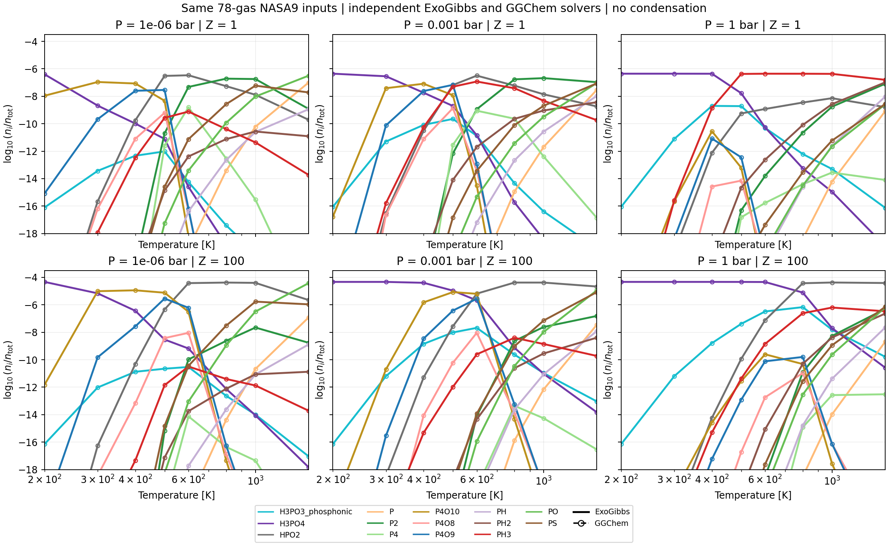
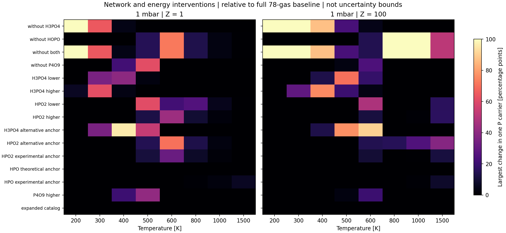
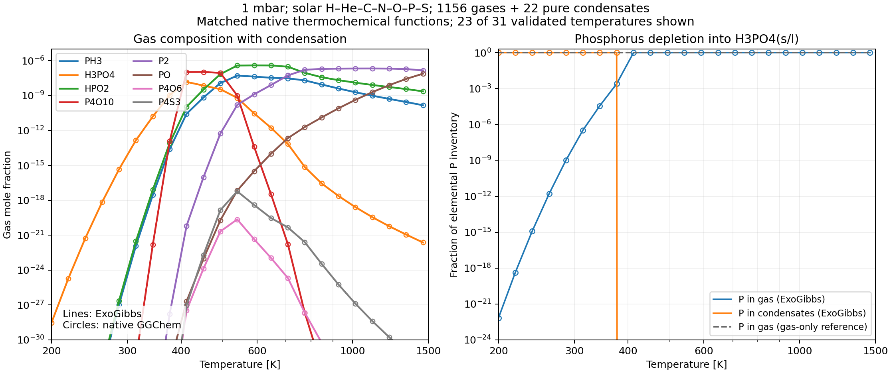

Cold phosphorus: network and solver validation
==================================================

The expanded gas network is numerically stable and agrees with GGChem. Its
remaining limitations include the selected thermochemical functions and
the treatment of condensed phases. Adding more available P gases has a much
smaller effect than changing the H3PO4 or HOPO energy anchors. These results
do not establish physical accuracy of a complete low-temperature atmosphere.

This 2026-10-31 follow-up keeps the previously reviewed Gurvich-family P4O6
choice and leaves production defaults unchanged. It extends the Ohno-style
comparison reported in `Issue #304
<https://github.com/HajimeKawahara/exogibbs/issues/304>`_.

Two deliberately different model scopes
-------------------------------------------

The controlled NASA9 experiment uses 78 neutral H/He/C/N/O/P/S gases, or 107
after adding 29 P-bearing identities. Every shared species retains the same
function. Temperatures are 200, 300, 400, 500, 600, 800, 1000 and 1500 K;
pressures are 1e-6, 1e-3 and 1 bar. Abundances are Asplund2021, with either
solar composition or C/N/O/P/S multiplied by 100 relative to unchanged H/He.
This is a seven-element experiment, not a full solar-element atmosphere.

The native GGChem condensation experiment uses its Burcat-priority input,
1156 neutral gases and 22 pure condensed phases, with the same seven solar
elements at 1 mbar. It samples 31 temperatures from 200 to 3000 K and has no
rainout. It is a separate thermochemical model: agreement between solvers
within either model does not establish agreement between these two datasets.

GGChem is pinned to commit
``65bbb8f9ca3d6c0b4e58cb7dd3862322452d0d4b``. ExoGibbs production code is
unchanged from ``33b2b0962afb05a4a3c06129e2cfaec3e0787dfc``.

Independent gas solver comparison
-------------------------------------

All 448 states pass both the primitive equilibrium checks and the comparison
with GGChem. They include the baseline, four deletion controls, ten
enthalpy interventions at 1 mbar, and the 107-gas expansion. Neither solver
receives the other solver's equilibrium as an initial guess. GGChem uses
the pinned SMCHEM16 solver with a NASA9 adapter; ExoGibbs and Fortran evaluate
the input functions separately.

.. list-table:: Maximum residuals over the declared gas experiment
   :header-rows: 1
   :widths: 65 35

   * - Quantity
     - Maximum
   * - Difference in independently evaluated ln K
     - 9.09e-13
   * - Difference in ln mole fraction, every gas including traces
     - 4.16e-9
   * - ExoGibbs relative element residual, without a trace-element floor
     - 1.03e-9
   * - ExoGibbs absolute log mass-action residual
     - 3.64e-12
   * - GGChem relative element residual
     - 7.11e-15
   * - GGChem absolute log mass-action residual
     - 2.64e-11

   Ohno-style log-temperature versus log mole fraction. Lines and markers
   overlay ExoGibbs and GGChem for the 48 baseline states. The receipt also
   checks all interventions and the expanded network, which are not drawn
   in this baseline figure.

What adding and changing gases does
---------------------------------------

The two pinned CEA2002/Burcat2016 source files contain 29 additional P gas
identities after excluding duplicate anchors, aliases and tritium PT. Isomers
with the same formula remain separate. Adding all 29 changes any single
P-carrier allocation by at most **0.00486 percentage points** over 48 states.
The added gases together never carry more than 0.00537% of total P.
This is convergence within a finite source catalog. P4S3 is absent from
these two NASA9 files; it is present in the separate native GGChem model.
Gases absent from both source files remain untested.
The HPO4 candidate also has an unresolved electronic-state annotation;
catalog inclusion is not a physical-data endorsement.

Energy anchors have much larger effects. The following examples refer to
gas-only, solar, 1-mbar states and change only enthalpy, preserving the
baseline entropy and heat capacity. They are diagnostic interventions,
not complete replacement datasets or probabilistic uncertainty bands.

.. list-table:: Selected source sensitivity examples
   :header-rows: 1
   :widths: 42 18 40

   * - Intervention
     - Temperature
     - P inventory in the named carrier
   * - H3PO4 reported alternative, -21.053888 kJ/mol
     - 400 K
     - H3PO4: 4.101% to 99.998%
   * - HOPO unused G3B3 alternative, +24.2672 kJ/mol
     - 600 K
     - HOPO: 71.892% to 1.369%
   * - HOPO experimental enthalpy anchor, +5.8576 kJ/mol
     - 600 K
     - HOPO: 71.892% to 40.553%
   * - P4O9 synthetic sensitivity probe, +10 kJ/mol
     - 500 K
     - P4O9: 61.363% to 19.984%

   Maximum change of one P-carrier allocation in percentage points at
   1 mbar. Uniform +/-8.368 kJ/mol probes are diagnostic scales; they do
   not represent identical, calibrated uncertainties for different species.

The selected NASA9 HOPO header quotes +/-1.5 kcal/mol and the NASA7 header
+/-2 kcal/mol. That annotation discrepancy is retained. Small polynomial
join errors and positive heat capacities verify the representation only;
the nominal temperature interval is not a physical validation interval.

What primary evidence adds
------------------------------

H3PO4 gas is selected from a Goos/Burcat G3B3 calculation at
-1118.709552 kJ/mol. The database gives computed frequencies and estimated
OH torsional barriers; the original calculation files were not recovered.
The -1139.76344 kJ/mol group-additivity alternative is quoted in Burcat's
comments. The `Khalfa et al. paper and supporting information
<https://doi.org/10.1021/acs.jpca.5b07071>`_ identify the method, but its
primary numerical table was not inspected here. The value therefore remains
a database-reported alternative.

`Saab et al. (2017) <https://arxiv.org/abs/1702.04379>`_ report no experimental
gas H3PO4 formation enthalpy. Their -1126.96 kJ/mol estimate combines a
liquid value with modeled vaporization. The quoted +/-2.90 kJ/mol belongs
to the liquid contribution and is not a total gas-phase uncertainty.
The separate Alexeev value quoted there has an erratum that was not
inspected; it is not used as a calibrated reference.

For HPO2 = HOPO, the independent equilibrium experiment of
`Hildenbrand and Lau (1994) <https://doi.org/10.1063/1.466782>`_ reports
-110.6 kcal/mol = -462.7504 kJ/mol. The publisher-deposited abstract was
inspected; full temperature coverage and uncertainty were not recovered.
This is closer to the selected Haworth value (-468.608) than the unused
G3B3 value (-444.3408). It supplies a reason to retain the selected anchor
as a working choice, while the 5.8576 kJ/mol difference still matters.
HPO itself has a larger unresolved CEA/theory/experiment discrepancy.
Replacing every P species with a Burcat entry is therefore unjustified.

Condensation and its limits
-------------------------------

The NASA9 insertion screen evaluates 29 pure condensed-phase records,
including six P phases, only inside their original polynomial intervals.
It uses ``ln S = A_cond dot mu_elements/(RT) - g_cond/(RT)``.
A positive value means that adding that phase lowers Gibbs energy from
the gas-only state; this screen is not a coupled multiphase solution.
Of 48 baseline states, 18 are unstable to at least one P condensate.

At solar abundance and 1 mbar, H3PO4 solid has ln S = 52.168 at 200 K
and 18.416 at 300 K. At 400 K the liquid has ln S = +0.306, but changing
only the gas H3PO4 anchor to the reported alternative changes it to
-2.831. Phase boundaries therefore inherit gas thermochemical uncertainty.

In the separate native GGChem gas-plus-condensate calculation, gas retains
almost all P at 411.77 K but only 0.2497% at 376.23 K, where liquid H3PO4
contains almost all the rest. At 200 K the gas retains 6.73e-23 of total P.
These values describe the specified pure-phase model, not a measured
condensation curve.

ExoGibbs independently reproduces **all 31 native gas-plus-condensate
states**, using its public production condensation solver with cold starts
and no supplied phase support. Maximum relative element error is 5.69e-10,
log mass-action error is 1.10e-11, and active-phase affinity error is
2.28e-13. No inactive phase has positive affinity. The largest difference
in a condensate's share of any elemental inventory is 1.09e-10.

Native GGChem clips printed densities below 1e-300 cm^-3. For gases above
ln mole fraction = -600, the maximum difference from its printed output is
2.37e-9 in ln mole fraction. Reconstructing trace gas fractions from its
atomic partial pressures and formation constants gives a maximum difference
of 5.87e-9 over every gas. That trace reconstruction is explicitly distinguished
from independently printed molecular abundances.

Both solvers use the same sampled native functions in this condensation
comparison. The original SUPERSAT routine exports condensed potentials
directly at unit atomic partial pressures without solving equilibrium.
Native CHECK_MELTING corrections are enabled for solid/liquid pairs;
NH4SH uses the native square-root saturation convention, so its formula-unit
potential is -2 ln S. Reconstructing the functions from a native equilibrium
afterwards agrees within 2.85e-9 RT. No native equilibrium supplies an
ExoGibbs seed. Native fits and their extrapolation behavior are reproduced
for solver comparison, without claiming physical validity over 200--3000 K.

   Matched native gas-plus-condensate functions, showing the 23 temperatures
   at or below 1500 K. ExoGibbs lines and GGChem
   markers agree; the P inventory panel shows the strong depletion of gas
   phosphorus after phosphoric acid condenses.

The seven-element catalog excludes metal phosphates and phosphides.
NH4H2PO4, which is present in other condensation databases and discussed
by `Visscher et al. (2006)
<https://solarsystem.wustl.edu/wp-content/uploads/reprints/2006/Visscher%20et%20al.%202006%20ApJ%20sulfur%20and%20phosphorus.pdf>`_,
is absent from both selected phase catalogs. Solutions, hydration and
rainout are also outside this experiment. The native 27-element condensation
attempt reached only 1111 K before termination; it is explicitly incomplete
and supplies no low-temperature validation.

Software decision and evidence record
-----------------------------------------

Keep molecular identity, phase, source, temperature interval and source
uncertainty attached to each record. Offer named, versioned datasets with
explicit alternatives; do not silently replace all P thermochemistry on
the basis of a database name. Missing H3PO4 and HOPO should be addressed
by an explicitly scoped cold-gas dataset, followed by phase-catalog and
source checks before promotion to a production default.

MCEG records numerical agreement, finite-catalog convergence, source
sensitivity and phase insertion separately. Physical accuracy of a complete
cold atmosphere remains UNKNOWN. The new contract is
``mceg/contracts/phosphorus_cold_validation.yaml``; source inspection is
``mceg/reviews/phosphorus_cold_sources_20261031.json``. Coefficient-free
receipts live in ``tests/data/validation/phosphorus_cold_validation/``.
Restricted external polynomial tables are not redistributed with the report.

The reproduction scripts are in ``mceg/reviews/``. First regenerate the
hash-pinned 78-gas fixture using ``build_phosphorus_cold_data.py`` and the
source catalog using ``phosphorus_cold_source_audit_20261031.py``. Then run
the following commands (the candidate option is required for all 448 states)::

   python mceg/reviews/phosphorus_cold_validation_20261031.py --candidate-input results/phosphorus_cold_validation/p_candidate_records.json
   python mceg/reviews/phosphorus_cold_ggchem_validation_20261031.py
   python mceg/reviews/phosphorus_cold_phases_20261031.py

The independent GGChem adapter,
compiler flags and input hashes are recorded in the comparison receipt.
Native exports are generated locally; sampled functions are evaluated only
at their exported knots, with no interpolation or new fit.

For the native comparison, first prepare ``results/ohno_p3/ggchem_upstream.zip``
from the pinned GGChem commit and run ``ohno_ggchem_20261031.py --run``.
Its archive hash is checked before building. Run the unchanged native
executable for the two supplied 31-point input files::

   python - <<'PY'
   from pathlib import Path
   import shutil
   import subprocess
   root = Path.cwd()
   fixture = root / "tests/data/validation/phosphorus_cold_validation"
   upstream = root / "results/ohno_p3/GGchem-65bbb8f9ca3d6c0b4e58cb7dd3862322452d0d4b"
   for mode in ("gas", "condensed"):
       run = root / "results/phosphorus_cold_validation" / f"native7_{mode}"
       run.mkdir(parents=True, exist_ok=True)
       if not (run / "data").exists():
           (run / "data").symlink_to(upstream / "data", target_is_directory=True)
       shutil.copyfile(fixture / f"native7_{mode}.in", run / "input.in")
       shutil.copyfile(fixture / "abundances.dat", run / "abundances.dat")
       with (run / "run.log").open("w") as log:
           subprocess.run([str(upstream / "ggchem16_original"), "input.in"],
                          cwd=run, stdout=log, stderr=subprocess.STDOUT, check=True)
   PY
   python mceg/reviews/phosphorus_native_phase_reference_20261031.py --export-input results/phosphorus_cold_validation/native7_phase_inputs.json
   python mceg/reviews/phosphorus_native_phase_export_20261031.py
   JAX_PLATFORMS=cpu python mceg/reviews/phosphorus_cold_condensate_comparison_20261031.py
   python mceg/reviews/phosphorus_native_phase_plot_20261031.py

The interrupted 27-element attempt is retained as a receipt only; reproducing
that incomplete attempt is not needed for either successful comparison.
