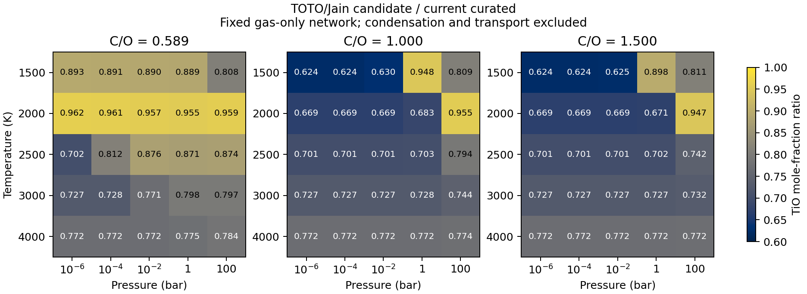

TiO candidate and finite equilibrium substitution
=================================================

This work completes the candidate construction and finite-substitution tasks
identified in :doc:`tio_source_review`. It evaluates a named replacement for
the existing TiO source on the same gas network. **Production curated data
remain unchanged.** Numerical support for this candidate and physical accuracy
of an atmosphere are recorded separately in the existing TiO MCEG contract;
the earlier source-only assessments and receipts remain historical records.

The model being tested
----------------------

``tio_48_internal_elemental_candidate_v1`` uses current TOTO 48Ti16O internal
levels to represent the existing element-aggregated TiO species. Molecular
translation uses **63.8664 u**, matching the NASA elemental masses
Ti = 47.867 u and O = 15.9994 u. The neutral-atom thermal functions and their
existing NASA reference gauge remain fixed. Standard pressure is 1 bar and the
candidate is defined only on **1500--4000 K**. This is a representative-isotope
approximation, not a full natural-isotope mixture or isotope-resolved network.

The energy anchor is **D0 = 6.824 +/- 0.010 eV**, from Jain et al. (2023),
`DOI 10.1063/5.0146365 <https://doi.org/10.1063/5.0146365>`_. The zero is the
lowest TiO rovibronic level relative to Ti(a3F2) + O(3P2). No further
zero-point-energy subtraction or theoretical spin-orbit correction is applied.
The former curated hybrid used BC/Luo D0 = 6.869 eV with JANAF thermal functions.
The inspected modern threshold and the obsolete JANAF singlet-origin assumption
provide the scientific motivation; historical NASA agreement is not the target.

The current TOTO states file has version 20240509, linked to the 2019 model
(`DOI 10.1093/mnras/stz1818 <https://doi.org/10.1093/mnras/stz1818>`_) and 2024
hybrid update (`DOI 10.1093/rasti/rzae037
<https://doi.org/10.1093/rasti/rzae037>`_). Its 48Ti16O nuclear spin factor is 1;
state weights already contain 2J+1 and both parity components. They must not
receive another electronic or spin multiplicity.

Of 301245 available levels, **300670** lie below the central D0 threshold of
55039.271828 cm-1 and enter the candidate. The 575 excluded levels change Q
by only 3.84e-9 at 4000 K relative to the full list. The central state inventory
is held fixed in D0-only uncertainty experiments, so those experiments isolate
the energy anchor rather than changing the thermal model at the same time.

One Gibbs function supplies all derivatives
-------------------------------------------

For excitation temperatures ``epsilon_i = E_i/k_B``, the source moments are
computed directly from ``w_i = g_i exp(-epsilon_i/T)``. With translational
number-density factor ``qtr = (2*pi*m*k_B*T/h**2)**(3/2)`` and standard
pressure ``p0``,

.. math::

   Q &= \sum_i w_i, \\
   (H-H_0)/R &= \tfrac52 T + \langle\epsilon\rangle, \\
   S/R &= \ln(Q q_{\rm tr} k_B T/p_0)
            + \tfrac52 + \langle\epsilon\rangle/T, \\
   C_p/R &= \tfrac52 + {\rm Var}(\epsilon)/T^2.

A piecewise quintic represents ``f = (G-H0)/R`` on six knots, separated by
500 K from 1500 to 4000 K. Endpoint conditions are ``f``, ``f' = -S/R`` and
``f'' = -Cp/(RT)``. This gives one C2 Gibbs function; H, S and Cp are its
derivatives, rather than independent fits. The reaction function is
``h = f/T - sum(g_atom_thermal) - D0/(k_B T)``, with ``ln K = -h``.
Here each ``g_atom_thermal = (G_atom-H_atom(0))/(RT)`` is dimensionless.

The frozen **45 off-knot** direct-state references give maximum absolute
interpolation errors of 1.024e-6 in ln K, 0.190 J/mol in H,
1.034e-4 J/(mol K) in S and **0.002492 J/(mol K)** in Cp. These are numerical
errors relative to the named finite state model. They are not estimates of its
spectroscopic uncertainty or atmospheric error. Positive molecular Cp and
boundary/derivative consistency are checked separately.

A comparison candidate uses **NASA molecular thermal functions with the same
new D0 and unchanged NASA atoms**. It is a useful economical thermal proxy;
it does not restore NASA's older energy anchor. It is evaluated independently
on the identical network to distinguish thermal-source sensitivity from the
much larger ground-energy update.

Approximation and completeness checks
-------------------------------------

The current states contain sixteen electronic manifolds, including the five
approximate D, F, g, h and i states used in the 2019 recommended partition.
Their 64937 source rows already contribute to the model; adding a separate
high-state correction would double count them. At 4000 K they account for
0.7206% of full-list Q, and deleting them changes Cp by -1.265 J/(mol K).
The candidate retains them. This source sensitivity is distinct from the much
smaller Gibbs-fit error.

At 4000 K, represented levels with J > 190 contribute 0.07284% of Q; deleting
them changes Cp by -0.2180 J/(mol K). These checks measure dependence on
represented states. They are not upper bounds for missing J > 200 levels or
unrepresented electronic states. A partition tabulated to 8000 K does not
establish physical completeness there. The candidate keeps the narrower
1500--4000 K scope.

The distributed PF and direct current-state sum differ by less than 4e-5 over
that interval. The candidate uses current-state moments consistently; the
older distributed PF remains a separately recorded source-version comparison.
The actual highest energy in the states file is 55658.305414 cm-1: the paper's
50000 cm-1 upper transition threshold must not be mistaken for the maximum of
every stored level.

Using the official `CIAAW titanium abundances
<https://www.ciaaw.org/titanium.htm>`_ with spin-normalized partitions gives
weighted Q / Q(48Ti16O) = 0.999385 at 1500 K and 0.999332 at 4000 K. Thus this
specific internal-partition diagnostic differs by at most **0.067%**. It assumes
common isotope D0; it omits isotope-dependent thresholds, explicit 17/18O
levels and isotope fractionation among network species. Terrestrial ratios are
reference sensitivities, not measured exoplanet compositions or a total error
bound. Changing the old JANAF molecular mass 63.8794 u to 63.8664 u separately
multiplies the molecular translational contribution by **0.999694753**.

Finite network response
-----------------------

The archived reference has 75 converged cases, 537 species and ions, spanning
1500--4000 K, 1e-6--100 bar and three C/O values. The finite substitution
changes TiO alone; all other chemical potentials, species, element budgets and
charge conventions remain identical. Both the TOTO candidate and the NASA
thermal proxy use the same 6.824 eV anchor. Absolute mole fractions and titanium
allocation are compared, because the ratio of formation constants is not an
abundance-response prediction.

All **150 new endpoints** converged: 75 for TOTO/Jain and 75 for the NASA
thermal proxy, compared with the 75 archived reference endpoints. Across the
grid, TOTO/Jain TiO mole fractions are **0.62426--0.96201 times** their current
values. The response depends on pressure, C/O and competing species even
though the imposed TiO formation-constant change depends only on temperature.

   Finite TiO abundance response for the three C/O budgets. Each cell is a
   solved mole-fraction ratio, not the ratio of formation constants. Condensation
   and transport are outside this fixed gas network.

The largest titanium-allocation change occurs at 1500 K, 100 bar and reference
C/O = 0.5888436554:

.. list-table:: Largest TiO budget response on the fixed gas network
   :header-rows: 1

   * - Model
     - TiO mole fraction
     - Titanium in TiO
   * - Current JANAF thermal + BC/Luo energy
     - 9.71304e-8
     - 60.5723%
   * - TOTO/Jain candidate
     - 7.85052e-8
     - 48.9572%
   * - NASA thermal + Jain energy proxy
     - 7.84331e-8
     - 48.9123%

The TOTO candidate reduces TiO by **19.18%** at this point and shifts
**11.615 percentage points** of titanium out of TiO. Most moves into TiO2,
whose titanium share rises from 38.6852% to 50.0854%. TiO2 functions were held
fixed; the experiment does not independently validate them. The maximum
proxy-versus-TOTO difference over every case and species is 0.009187 in ln
mole fraction, a multiplicative difference of about 0.923%. The proxy is close
for this finite gas grid, but its inherited thermal ancestry is less direct.

A five-point interpolation of TiO's formation potential from current to TOTO
produces a monotonic TiO decrease at the highlighted case. Holding the central
thermal inventory fixed and changing only D0 to 6.814/6.834 eV gives TiO mole
fractions **7.54098e-8 to 8.16055e-8** there. This is a local energy sensitivity,
not a propagated confidence interval for all thermochemical sources.

Recomputed Ti and O budget residuals are below 5.08e-10 and 1.50e-13,
respectively. The largest relative residual over all elements is 2.56e-6,
associated with trace-element accounting. Native charge and log mass-action
residuals are below 7.04e-14 and 1.48e-12. Tight solves at three selected cases
change all-species ln mole fractions by at most 2.56e-5; the corresponding TiO
change is below 3.24e-12 in ln mole fraction. FastChem independently reproduces
all species for the three models at the highlighted condition within
6.80e-9 dex; its charge and mass-action residuals remain below 2.58e-12 and
2.52e-10.

Evaluating both solutions under each *same* chemical-potential vector checks
minimum-Gibbs consistency. The raw smallest reference-side difference,
-1.9463e-12, is explained by a -2.0139e-12 first-order contribution from the
small mismatch in conserved budgets; subtracting that contribution gives
+6.7615e-14 for the case. Correcting this feasibility term over the full grid
reduces wrong-sign residuals to below 1.4e-18. This supports numerical
minimization consistency. Comparing different models' absolute Gibbs values
is not used as physical evidence for choosing the candidate.

Scientific assessment and remaining decision
--------------------------------------------

**TOTO/Jain is the scientifically preferred candidate for a separate curated
update on 1500--4000 K.** It replaces an identified obsolete thermal assumption
with modern state-resolved thermodynamics and a more precise experimental
ground energy. Its compact derivative-consistent representation and completed
fixed-network substitution support that scoped choice. The NASA/Jain proxy is
a useful close approximation on this grid, not the first choice when the more
direct modern source is already implemented and checked.

This is a limited adoption-readiness judgment, not production adoption or
physical validation. The numerical representation has a declared domain and
reproducible source inventory. Isotope and upper-state sensitivities remain
separate from interpolation precision. No further historical-paper retrieval
is required to review the completed candidate and its finite response.

This work does not certify absolute atmospheric accuracy. Condensation, rainout,
cold trapping, transport, irradiation and radiative transfer are absent from
the fixed gas network; the full physical uncertainty, including correlations
in atomic and molecular data, has not been inferred. The energy-only +/-0.010 eV
experiment cannot be interpreted as a total abundance confidence interval.
Neither tiny numerical errors nor agreement between solvers removes these
limitations.

The existing ``tio_source_review.yaml`` contract adds separate candidate and
finite-substitution subjects and assessments. Completion records resolve
``complete_modern_candidate`` and ``finite_substitution`` for this explicit
representative-isotope model. They do not retroactively change the old
source-only assessments or turn unknown physical accuracy into supported
validation. Missing every historical Luo or Gurvich original is not a condition
for the completed modern calculation. Adopting the candidate in production
curated remains a separate, scoped decision.

Reproduction and evidence
-------------------------

``tests/data/validation/tio_candidate/20261103`` contains the compact Gibbs
coefficients, direct-state references, source inventory, sensitivities and
receipt. Its original full ExoMol files are identified by URL and hash; they
are needed to reconstruct the extraction, but not to evaluate or test the
frozen candidate offline. The finite calculation and its diagnostics are
recorded in ``tests/data/validation/tio_equilibrium_impact/20261103``.

The review-only modules are ``mceg/reviews/tio_candidate.py`` and
``mceg/reviews/tio_equilibrium_impact.py``. Their offline evidence tests replay
the compact model and verify the saved solved states. Neither module changes
installed curated data or introduces an MCEG runtime dependency.
