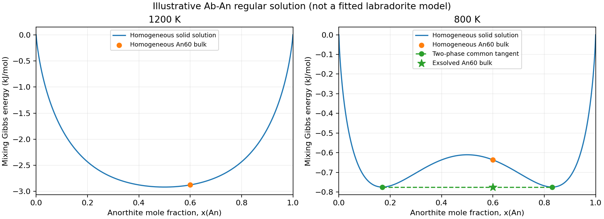

Plagioclase exsolution: a multiphase tutorial
=============================================

Exsolution separates a solid solution into phases with different compositions.
Labradorite provides a geological motivation: its fine intergrowths contain
Na-rich and Ca-rich plagioclase. Crystal ordering and the resulting structures
are described by `Götz, Kleebe, and Kolb (2022)
<https://doi.org/10.5194/ejm-34-393-2022>`_.

This tutorial uses a **teaching regular-solution model**, with an illustrative
interaction energy. It demonstrates equilibrium partitioning through the
public ``exogibbs.api.multiphase`` API. It is not a calibrated model of the
Bøggild gap or the other miscibility gaps in natural plagioclase. Ordering,
coherency strain, diffusion, lamellar spacing, and optical colors are outside
this calculation.

Run the example
---------------

From an installed checkout, run:

.. code-block:: console

   python examples/plagioclase_exsolution.py

The :download:`complete example <../examples/plagioclase_exsolution.py>`
uses no external provider or data. It prints phase compositions, phase amounts,
and Gibbs energies, and saves ``results/plagioclase_exsolution.png``. Use
``--output PATH`` to choose another figure path. The left panel shows the hot
homogeneous solution; the right panel shows how a cold two-phase assemblage
lowers the Gibbs energy.

   Generated with the example's default parameters. The orange point is
   homogeneous An60. At 800 K, the green star is the lower energy of the
   exsolved bulk, composed of the two phases marked by green circles.

1. Define components and conserve atoms
----------------------------------------

Both phases contain the same two endmembers:

* Ab: albite, NaAlSi\ :sub:`3`\ O\ :sub:`8`.
* An: anorthite, CaAl\ :sub:`2`\ Si\ :sub:`2`\ O\ :sub:`8`.

Let :math:`x=n_{\rm An}/(n_{\rm Ab}+n_{\rm An})`. Start with one mole of
bulk An60, meaning 0.4 mol Ab and 0.6 mol An. In the row order
``(Na, Ca, Al, Si, O)``, each phase uses

.. math::

   A = \begin{pmatrix}
       1 & 0 \\
       0 & 1 \\
       1 & 2 \\
       3 & 2 \\
       8 & 8
   \end{pmatrix},
   \qquad
   b=A\begin{pmatrix}0.4\\0.6\end{pmatrix}
    =\begin{pmatrix}0.4\\0.6\\1.6\\2.4\\8.0\end{pmatrix}.

The entries of :math:`b` are mol atoms. Two ``Phase`` objects, named
``plagioclase_alpha`` and ``plagioclase_beta``, share this matrix and the
same Gibbs callback. Their independent amounts allow different compositions.
They represent two portions of the same solid solution, not pure Ab and pure
An, and are not separate crystal-structure models.

2. Supply an extensive Gibbs energy
------------------------------------

For either phase, the callback returns :math:`G=n g(x,T)` in joules, with

.. math::

   g(x,T) = RT\big[(1-x)\ln(1-x)+x\ln x\big] + W x(1-x).

Here :math:`n=n_{\rm Ab}+n_{\rm An}`, :math:`R=8.31446261815324`
J mol\ :sup:`-1` K\ :sup:`-1`, and the **illustrative** coefficient is
:math:`W=16000` J mol\ :sup:`-1`. The ideal entropy term favors mixing;
the positive excess term penalizes mixing. The callback receives :math:`W`
through the explicit ``parameters`` argument.

Both phases use the same endmember reference. The linear endmember terms
have been subtracted: their sum is constant at fixed temperature and bulk
Ab/An amounts, so they do not affect this partitioning problem. Reported
energies are relative mixing energies, not formation Gibbs energies. Pressure
is supplied as :math:`10^5` Pa; this model has no pressure dependence.

At high temperature this symmetric model is strictly convex because

.. math::

   \frac{\partial^2 g}{\partial x^2}
   = \frac{RT}{x(1-x)}-2W > 0
   \quad\hbox{when}\quad
   T>T_c=\frac{W}{2R}\simeq962.18\ {\rm K}.

The numerical value of :math:`T_c` belongs to this teaching model, not to
measured labradorite. Below :math:`T_c`, a common tangent can connect two
compositions with lower energy than the homogeneous bulk between them.

3. Compare one-phase and two-phase supports
--------------------------------------------

The component order is ``[Ab(alpha), An(alpha), Ab(beta), An(beta)]``.
The example calls ``solve_fixed_support`` for three states:

.. list-table::
   :header-rows: 1
   :widths: 22 12 24 42

   * - State
     - T (K)
     - Positive component indices
     - Interpretation
   * - ``hot_single``
     - 1200
     - ``(0, 1)``
     - Homogeneous solid solution above the model's critical temperature
   * - ``cold_single``
     - 800
     - ``(0, 1)``
     - Homogeneous reference constrained to remain one phase
   * - ``cold_split``
     - 800
     - ``(0, 1, 2, 3)``
     - Two solid solutions allowed to exchange Ab and An

The split solve starts at An10 and An90, with amounts chosen to conserve the
An60 bulk. These are initial guesses; minimization determines the final
compositions and amounts. Swapping the phase labels describes the same state.
There is no time integration or cooling-rate calculation.

All three states pass the checks on their declared supports. In particular,
the cold one-phase state can pass ``minimum_valid`` because its composition
is fixed by conservation when splitting is forbidden. That flag alone does
not establish stability against formation of another phase.

4. Read the coexistence result
-------------------------------

At 800 K the example finds approximately:

.. list-table::
   :header-rows: 1
   :widths: 32 24 22 22

   * - State or phase
     - An mole fraction
     - Amount (mol)
     - Total G (J)
   * - Homogeneous reference
     - 0.600000
     - 1.000000
     - -636.584278
   * - Na-rich alpha
     - 0.169141
     - 0.348878
     -
   * - Ca-rich beta
     - 0.830859
     - 0.651122
     -
   * - Combined alpha + beta
     - 0.600000 (bulk)
     - 1.000000
     - -774.764735

Splitting lowers G by about 138.18 J for this one-mole sample at 800 K.
Both phases remain mixtures. The straight line connecting their points in
the plot is the common tangent; a point on it is an amount-weighted mixture
of the two phases. The bulk lies on this line after exsolution.

For this symmetric model the coexistence compositions obey

.. math::

   x_\beta=1-x_\alpha,\qquad
   RT\ln\frac{x_\alpha}{1-x_\alpha}+W(1-2x_\alpha)=0,
   \qquad 0<x_\alpha<\tfrac12.

The noncentral root gives the left minimum; symmetry gives the right one.
They have the same energy and a horizontal common tangent. The amount
fractions follow the lever rule:

.. math::

   f_\beta=\frac{x_{\rm bulk}-x_\alpha}{x_\beta-x_\alpha},
   \qquad f_\alpha=1-f_\beta.

The tests independently check this scalar coexistence equation, the lever
rule, equal Ab and An chemical potentials across phases, and all five
element balances. At 1200 K, strict convexity establishes that homogeneous
An60 is the equilibrium for this model. At 800 K, the symmetric double-well
construction establishes the two-phase equilibrium for the stated bulk.

The API still reports ``stability_status="unchecked"``: this tutorial selects
supports explicitly and does not request a host insertion audit. The analytic
reasoning here applies to this binary model; it is not a general stability
certificate supplied by the solver. See :doc:`multiphase` for phase searches
and insertion-bound contracts.
