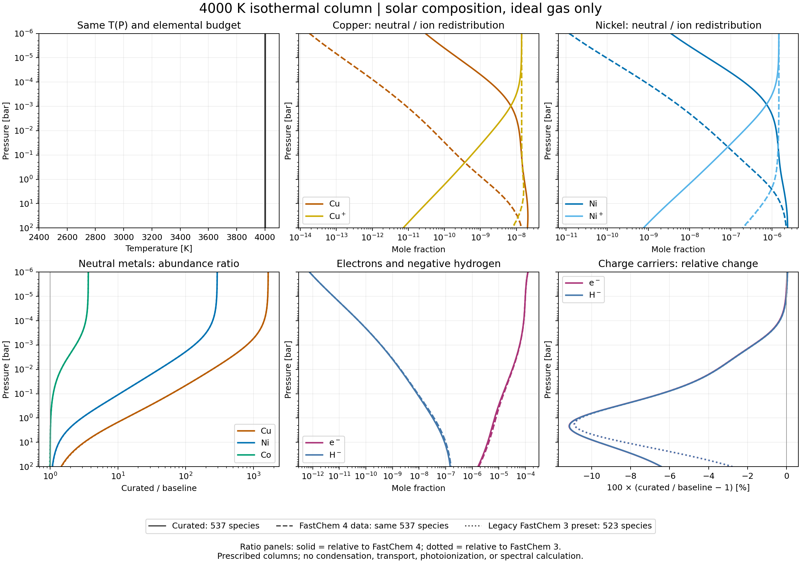
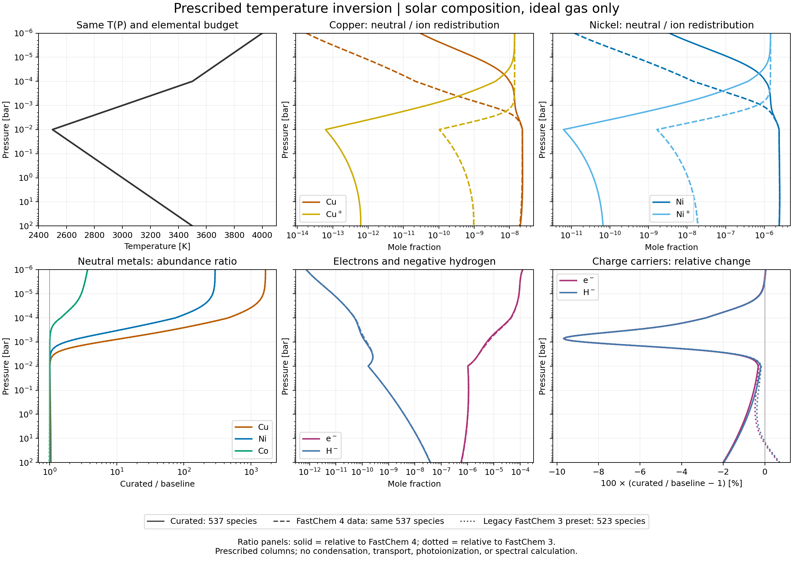

Curated Gas Preset
==================

``exogibbs.presets.curated`` provides the approved atomic-ion and major-molecule
source choices as continuous, JAX-differentiable gas thermochemistry.
The first dataset, ``curated-gas-v1``, covers **1500--4000 K** and uses a standard
pressure of **1 bar**. It returns the same native ``ChemicalSetup`` type as
the other presets and requires neither MCEG nor a FastChem executable.

Quick start
-----------

Enable float64 before constructing the setup. The explicit tolerance below
matches the validation runs, including trace-element abundances.

.. code-block:: python

   import jax
   jax.config.update("jax_enable_x64", True)

   from exogibbs.api.gas import EquilibriumOptions, solve
   from exogibbs.presets.curated import chemsetup

   setup = chemsetup()
   result, diagnostics = solve(
       setup, T=2517.0, P=0.01,
       b=setup.element_vector_reference,
       options=EquilibriumOptions(epsilon_crit=1e-13),
       return_diagnostics=True,
   )
   print(diagnostics["converged"])
   print(result.x[setup.species.index("e1-")])
   print(setup.metadata["dataset"], setup.metadata["data_sha256"])

The reference abundance vector reads the packaged Asplund, Amarsi & Grevesse
(2021) file explicitly, normalizes the nuclear abundances to one, and appends
zero net charge. Its C/O is 0.5888436554. This is the same budget used in
:doc:`../gas_thermochemistry_impact`, including that file's Ge abundance.
Supply another vector with ``b=`` to change the elemental composition; its
order is ``setup.elements``. Validation of a different composition remains
the caller's responsibility.

Networks
--------

.. list-table:: Explicit, fixed species sets
   :header-rows: 1

   * - Construction
     - Nuclear elements
     - Species
     - Charge treatment
   * - ``chemsetup()`` or ``chemsetup(ions=True)``
     - 27
     - 537
     - Positive/negative ions, electron and H- included
   * - ``chemsetup(ions=False)``
     - 27
     - 421
     - Neutral species only; no electron or charge constraint

The elements are Al, Ar, C, Ca, Cl, Co, Cr, Cu, F, Fe, Ge, H, He, K, Mg, Mn,
N, Na, Ne, Ni, O, P, S, Si, Ti, V and Zn. Ion-inclusive setups append ``e-``
to the constraint labels. Both networks use the same neutral thermochemistry.
The neutral network is an explicit approximation and does not extend the
temperature domain. Species are never added or removed as temperature changes.
An extended-element network is deferred until its additional source choices
are reviewed. Existing ``fastchem`` and ``fastchem4`` presets remain available.

Source policy and provenance
----------------------------

The model combines :doc:`../atomic_ion_adoption` and
:doc:`../major_molecule_adoption`:

* 43 atomic-ion NASA thermal functions have updated spectroscopic thresholds.
  Co+, C-, Ca- and Ge- use the adopted partition models. N- and Zn- are excluded.
* 35 major molecules carry explicit preferred, conditional or provisional
  decisions; 23 change numerical constants and 12 retain the existing fits.
* 427 other species retain pinned FastChem4 constants and are marked
  ``inherited_unreviewed``. The 27 atoms and electron define the zero reference
  gauge. This is not a claim that all 537 species have been independently audited.

Use ``setup.metadata["species_provenance"][species]`` for a species decision,
``["sources"]`` for source references, and ``["abundances"]`` for the reference
composition file and hash. The per-species adoption records retain the earlier
studies' review scopes and physical follow-ups; the setup's
``temperature_range_K`` gives the runtime domain. Dataset, baseline and abundance
file hashes are checked at construction. No online resources are read.

JANAF CH4/COS/TiO/VO H, S and Cp fix the value and first two derivatives of a
piecewise quintic free energy at 1500, 2000, 3000 and 4000 K. This produces a
C2 representation, tested against 22 unused JANAF rows per molecule. The
five required neutral/cation partition functions use positive Boltzmann sums
fitted to the adopted BC tables; evaluated anion levels are summed directly.
The fitted excitation terms are numerical coefficients, not newly identified
atomic levels. These representations preserve the approved source policy.

``hvector_func(T)`` accepts scalar or array temperatures and returns species on
the last axis. JIT, vectorization, and temperature derivatives are supported.
Out-of-domain or nonfinite temperatures return NaN. There is no fallback or
extrapolation. The returned formation-gauge h is for equilibrium; it is not an
absolute entropy or heat-capacity API for the entire mixture.

Numerical closure
-----------------

The ion-inclusive curated setup enables
``metadata["relative_charge_convergence"]``. The gas solver then includes
relative closure of signed constraints, including charge, in its stopping
residual. This opt-in mode preserves existing presets and condensate initializers.
For charge the denominator is the total
absolute charge carried by all species plus the absolute requested net charge.
Diagonal regularization of signed constraints scales with their own matrix diagonal;
a fixed absolute shift previously overwhelmed weakly ionized cases.

At the default tolerance, all 20 original ion-inclusive test conditions satisfy
relative charge error below 1e-10 in float64. The explicit ``1e-13`` setting
in the example also resolves the small elemental budgets used in the broader
comparison. The reported numerical tests use seven temperatures, including
1735, 2517 and 3973 K away from the original table nodes, at five pressures
from 1e-6 to 100 bar, for both networks. Nuclear conservation, relative charge
closure, all-species mass action and independent FastChem agreement are checked.

All 70 conditions pass. Maximum relative nuclear-budget and charge residuals
are 2.82e-6 and 6.51e-14; the maximum mass-action residual is 1.18e-12 in natural
log units. Independent FastChem v4.0.3 differences are below 1.23e-6 dex for
species above 1e-12 mole fraction, 1.23e-5 dex over all species, and 8e-11 dex
for both electrons and H-. These gates use the same pinned standalone build
as the preceding source-impact study.

These checks establish implementation and source-representation agreement.
They do not validate the physical accuracy of the complete mixture, resolve
the provisional CH4/metal-hydride choices, or establish applicability of ideal
gas-only equilibrium at every sampled pressure. Condensation, rainout,
external ionization and density-dependent level dissolution are outside this
preset's model.

Atmospheric column demonstration
--------------------------------

``examples/comparisons/demo_curated_atmosphere.py`` compares two prescribed
solar-composition columns, each with 161 layers from 1e-6 to 100 bar. A 4000 K
isothermal column samples the large neutral-Cu/Ni effects found in the preceding
fixed-grid study. A second column uses a temperature inversion: T = 4000, 3500,
2500, 3000 and 3500 K at log10(P/bar) = -6, -4, -2, 0 and 2, with linear
interpolation in log pressure. These are illustrative local-equilibrium columns,
not radiative-convective solutions, measured planetary profiles or a global
search for the largest possible difference.

In the preceding 20-state grid, the largest eligible absolute log-ratio was
Cu+ at 2000 K and 1e-4 bar: adopted/FastChem = 0.0006012, about 1/1663.
The 4000 K column instead samples the grid's largest neutral-Cu/Ni responses.

.. list-table:: Meaning of each plotted comparison
   :header-rows: 1

   * - Curve
     - Species
     - Interpretation
   * - Curated, solid
     - 537
     - Adopted gas-v1 data
   * - FastChem 4, dashed
     - Same 537
     - Original full gas table, with N- and Zn- removed; isolates data changes
   * - Legacy FastChem 3, dotted
     - Original 523
     - Original ``fastchem.chemsetup()`` catalog; includes catalog changes

Every curve uses the same explicit Asplund 2021 budget, temperature, pressure,
float64 solver, relative-charge mode and epsilon_crit = 1e-13. Thus the legacy
curve compares the old data/catalog with numerical convergence controlled;
it does not compare the default stopping criteria or abundance vectors.
The no-argument ``fastchem4.chemsetup()`` excludes ions, so it is deliberately
not the charge-inclusive baseline. All **966 layer/model calculations** pass
element, charge and mass-action checks.

   Isothermal column. Pressure increases downward. Absolute mole fractions
   accompany the abundance ratios: large ratios for a trace metal do not imply
   a comparably large opacity or electron-density change. In ratio panels,
   solid curves use FastChem 4 as denominator and dotted curves use FastChem 3.

.. list-table:: Selected extrema relative to FastChem 4 in the 4000 K column
   :header-rows: 1

   * - Species
     - P (bar)
     - Legacy mole fraction
     - Curated mole fraction
     - Curated / legacy
   * - Cu
     - 1e-6
     - 1.7950e-14
     - 2.9672e-11
     - 1652.99
   * - Ni
     - 1e-6
     - 1.1876e-11
     - 3.4748e-9
     - 292.584
   * - e-
     - 2.23872
     - 6.3686e-6
     - 5.6586e-6
     - 0.888507
   * - H-
     - 2.23872
     - 5.5816e-8
     - 4.9601e-8
     - 0.888644

The maximum absolute log10 ratio is ranked only where either model reaches
a mole fraction of 1e-12. Cu is the largest effect in these sampled columns.
At the same upper boundary, the legacy FastChem 3 ratios are 1653.03 for Cu
and 292.592 for Ni. The altered atomic-ion constants redistribute each metal
between neutral and ionized species, while charge neutrality couples electrons
to the entire network. Source-adoption reasons are in :doc:`../atomic_ion_adoption`;
an abundance ratio is not an independent measurement of thermochemical accuracy.

   Prescribed temperature inversion. The largest electron and H- reductions
   relative to FastChem 4 are about 9.68% and 9.67%, at 3075 K and 7.079e-4 bar.
   Condensation, vertical transport and photoionization are omitted; no spectrum
   or opacity is calculated.

Reproduce both figures and the full primitive arrays offline::

   JAX_PLATFORMS=cpu python examples/comparisons/demo_curated_atmosphere.py \
       --output-dir /tmp/exogibbs_curated_atmosphere

The :download:`column receipt <../../results/curated_atmosphere/receipt.json>`
records the profiles, catalogs, closure diagnostics and input/output hashes.
The :download:`per-species extrema <../../results/curated_atmosphere/summary.csv>`
include both legacy baselines. PDF figures are available for
:download:`the isothermal column <../../results/curated_atmosphere/isothermal.pdf>`
and :download:`the inverted column <../../results/curated_atmosphere/inverted.pdf>`.

Artifacts and reproduction
--------------------------

* :download:`Validation receipt <../../results/curated_gas_validation/receipt.json>`
  and :download:`thermal representation checks <../../results/curated_gas_validation/thermal_checks.json>`.
* :download:`Solver diagnostics <../../results/curated_gas_validation/diagnostics.csv>`,
  :download:`default-tolerance charge checks <../../results/curated_gas_validation/default_charge.csv>`,
  and :download:`independent FastChem comparison <../../results/curated_gas_validation/fastchem_parity.csv>`.
* :download:`Ion-inclusive arrays <../../results/curated_gas_validation/ions.npz>`
  and :download:`neutral arrays <../../results/curated_gas_validation/neutral.npz>`.
* :download:`MCEG model contract <../../mceg/contracts/curated_gas.yaml>`.
* :download:`Wheel/sdist and isolated-import verification <../../results/curated_gas_validation/packaging.json>`.
* :download:`Initial preset regression record <../../results/curated_gas_validation/tests.json>`
  and :download:`full PR test run, including the atmosphere demo <../../results/curated_gas_validation/pr_tests.json>`.

Reproduce the offline checks in a scratch directory::

   JAX_PLATFORMS=cpu python examples/comparisons/validate_curated_preset.py

To include an already built independent FastChem executable::

   OMP_NUM_THREADS=5 JAX_PLATFORMS=cpu python examples/comparisons/validate_curated_preset.py \
       --fastchem-executable /path/to/fastchem

The default output directory is ``/tmp/exogibbs_curated_validation``, preserving
the archived evidence. FastChem receives each evaluated temperature's constants
on the identical network, with independent initialization. Its extra zero-electron
output column is excluded in the neutral comparison. Generated constant files
are valid at that temperature only and are never used as runtime fits.
