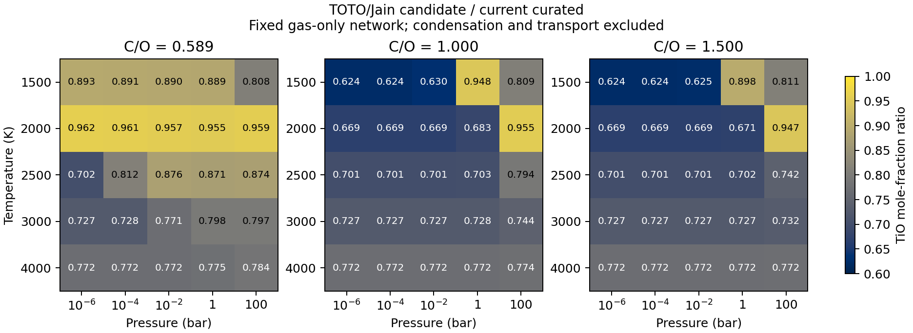

Curated gas with modern TiO thermochemistry
===========================================

``exogibbs.presets.curated_tio.chemsetup()`` selects the versioned
**curated-tio-v1** model. The public default selected this model at its
2026-11-03 adoption; the current default is described in :doc:`curated_h2o`.
This version adopts the reviewed
ExoMol TOTO internal-state model and Jain et al.'s measured dissociation energy
for TiO. Only TiO's formation function changes from **curated-c2h-v1**; the
C2H correction, other thermochemistry, species sets and elemental budgets
are retained. The domain remains **1500--4000 K**, with a standard pressure
of **1 bar**.

Reproduce the TiO version or its predecessors explicitly::

   import jax
   jax.config.update("jax_enable_x64", True)
   from exogibbs.api.gas import EquilibriumOptions, solve
   from exogibbs.presets import curated_tio, curated_c2h, curated_v1

   setup = curated_tio.chemsetup()      # TOTO/Jain TiO, before CO2/H2O adoption
   previous = curated_c2h.chemsetup()    # C2H correction, previous TiO hybrid
   original = curated_v1.chemsetup()    # Original curated-gas-v1
   result = solve(setup, T=2000., P=0.01,
                  b=setup.element_vector_reference,
                  options=EquilibriumOptions(epsilon_crit=1e-13))

All three factories support ``ions=False``. This version retains 537
species with ions and 421 neutral species without ions. JAX scalar/array
evaluation and temperature derivatives are supported; nonfinite or
out-of-domain temperatures return NaN. Runtime evaluation requires neither
MCEG, a FastChem executable nor original ExoMol downloads.

Why this source choice is adopted
---------------------------------

The preceding TiO hybrid combined JANAF thermal functions with the
Barklem--Collet/Luo energy, D0 = 6.869 +/- 0.061 eV. The JANAF evaluation dates
to December 1973 and explicitly assumes an a1Delta electronic origin of
1000 +/- 1000 cm^-1. Modern TOTO has its lowest a1Delta rovibronic level at
3446.481388 cm^-1. These are not exactly the same quantity: zero-point energy
and the lowest allowed rotational level separate an electronic origin from a
rovibronic minimum. Nevertheless, the identified old assumption warrants
replacing the legacy thermal model with modern state-resolved thermodynamics.
After matching conventions, modern internal partition functions are about
12--13% below JANAF over this domain.

Jain et al. (2023), `DOI 10.1063/5.0146365
<https://doi.org/10.1063/5.0146365>`_, determine **D0 = 6.824 +/- 0.010 eV**.
The 0.045 eV shift is within the old quoted +/-0.061 eV uncertainty; it does
not establish that the old value was statistically inconsistent. Adoption
favors the more precise measurement with an explicit lowest-atom asymptote,
together with the improved thermal model. It does not chase agreement with
historical NASA constants.

The TOTO model is described in McKemmish et al. (2019),
`DOI 10.1093/mnras/stz1818 <https://doi.org/10.1093/mnras/stz1818>`_, and its
hybrid update in McKemmish et al. (2024), `DOI 10.1093/rasti/rzae037
<https://doi.org/10.1093/rasti/rzae037>`_. The primary texts and source
conventions needed for this choice were inspected. Missing historical Luo
or Gurvich originals are recorded traceability follow-ups, not prerequisites
for adopting the independently specified modern model.

The decision is supported for this scoped gas model. Complete thermochemical
uncertainty and physical atmospheric accuracy remain unknown. These are
separate assessments, not reasons to retain a known obsolete thermal assumption.

The adopted numerical model
----------------------------

The production data contain the exact six-knot Gibbs representation developed
in :doc:`../mceg/tio_candidate`, without refitting it during adoption:

* Current TOTO version 20240509, with 48Ti16O internal levels representing
  element-aggregated TiO. Nuclear-spin factor is one and the supplied 2J+1
  degeneracies are not multiplied again.
* Molecular translation uses 63.8664 u, consistent with the existing NASA
  elemental masses. Existing neutral Ti and O thermal references are retained.
* The energy zero is the lowest molecular rovibronic level relative to
  Ti(a3F2) + O(3P2). No additional zero-point or theoretical spin-orbit
  correction is applied to Jain's measured D0.
* The central 6.824 eV bound-state cutoff retains 300670 of 301245 source
  levels. The current states already include the five approximate high
  electronic manifolds discussed in the 2019 partition-function supplement;
  they are not added a second time.
* A single C2 quintic Gibbs function uses knots at 1500, 2000, 2500, 3000,
  3500 and 4000 K. Its derivatives define consistent H, S and Cp.

Against 45 frozen independent off-knot state sums, the maximum fit errors are
1.024e-6 in ln K and 0.002492 J/(mol K) in Cp. Those are representation errors
relative to the selected finite-state model, not physical error estimates.
The separately distributed partition-function table and current states differ
by less than 4e-5 here; the adopted values and derivatives consistently use
the current states instead of mixing versions.

The representative-isotope approximation is proportionate to this application.
Weighting the five Ti-isotope partition functions by terrestrial reference
fractions changes internal Q by at most about 0.067% relative to 48Ti16O over
1500--4000 K. This is smaller than the identified legacy thermal discrepancy
and the measured D0 uncertainty. It is a sensitivity at common D0, not a
complete isotope error bound: oxygen isotopes, isotope-dependent D0 and
fractionation are not resolved. Upper-state and high-J truncation tests are
also sensitivities rather than bounds on missing states. These limits are
preserved in the production source record.

What changes in equilibrium
---------------------------

The preceding :doc:`finite-substitution calculation <../mceg/tio_candidate>`
re-equilibrated the fixed 537-species gas network at 75 conditions spanning
five temperatures, five pressures from 1e-6 to 100 bar, and reference C/O,
C/O = 1 and C/O = 1.5. The adopted candidate's TiO mole fraction is
**0.62426--0.96201 times** the preceding model's value on that grid.

The largest titanium-allocation change occurs at 1500 K, 100 bar and reference
C/O = 0.58884. TiO's share of titanium changes from **60.5723% to 48.9572%**,
and its mole fraction from **9.7130e-8 to 7.8505e-8**, a 19.18% reduction.
Other species respond through the shared elemental budgets even though their
formation functions stay fixed. This response is neither a direct prediction
of observed TiO nor a validation of the unchanged competing Ti-bearing data.

NASA thermal functions combined with the same Jain energy provide a close
comparison approximation: the largest all-species difference from TOTO/Jain
on this grid is 0.009187 in ln mole fraction, about 0.923%. TOTO/Jain is adopted
because its thermal source directly addresses the identified legacy problem
and its consistent numerical representation is already available.

   Candidate-stage finite substitution relative to the preceding
   C2H-corrected model. These gas-only calculations omit condensation and
   cold trapping; opacity or spectral effects are not calculated.

Production verification
------------------------

The public default at TiO adoption was independently constructed and cold-solved for
**75 cases per network, 150 in total**, with float64 and tolerance 5e-14.
All cases pass. Maximum relative elemental residuals are below 1.35e-6
(set by trace elements), the relative charge residual is below 2.15e-14,
and the mass-action residual is below 1.20e-12 in natural log units.

The production potentials match the archived candidate within 1e-12, with
unchanged species, formula matrices, reference budgets and all non-TiO
formation functions. For the ion-inclusive solutions, the maximum
all-species change from the earlier candidate execution is 2.544e-5 in ln
mole fraction, consistent with the tighter stopping tolerance and trace-species
numerical residuals. This production run adds no new independent-solver or
observational validation; those scopes remain explicit in the earlier study.

The saved full states, input/output hashes and diagnostics are in
``tests/data/validation/curated_tio_adoption/20261103``. The replay script now
selects ``curated_tio`` explicitly. Reproduce into a new
directory::

   JAX_PLATFORMS=cpu JAX_ENABLE_X64=1 PYTHONPATH=src \
     python mceg/reviews/curated_tio_adoption.py \
     --output-dir results/curated-tio-adoption-replay

MCEG separately records supported ``scientific_selection_review`` and
``production_adoption_review``, with ``physical_accuracy_review`` remaining
``unknown``. The packaged ion-inclusive lookup is
``exogibbs.curated_tio.v1``; neutral-mode verification is recorded directly
in the same contract. The earlier C2H and HCN records retain their dataset
identities and are not rebound to subsequent defaults.

Reproduction and limits
------------------------

``src/exogibbs/data/curated/tio_v1.json`` pins the adopted model and its
``curated-c2h-v1`` base. The previous JSON datasets retain their original
bytes and identities. Rebuild the small production payload offline::

   python mceg/reviews/build_tio_adoption.py --output /tmp/tio_v1.json

Candidate source extraction, derivative checks and finite substitution remain
in their own archives. The production adoption has a separate record under
``tests/data/validation/curated_tio_adoption/20261103`` and a separate contract,
``mceg/contracts/curated_tio.yaml``. Earlier TiO source-only and candidate-stage
assessments remain historical; numerical support never changes their unknown
physical-validation assessment into a pass.

The gas model omits condensation, rainout, cold traps, transport, irradiation,
nonideality and radiative transfer. These limit atmospheric interpretation but
do not require postponing a better specified gas thermochemistry model.
Neither solver agreement, a small interpolation error nor the energy-only
experimental uncertainty establishes a total atmospheric abundance error bar.
