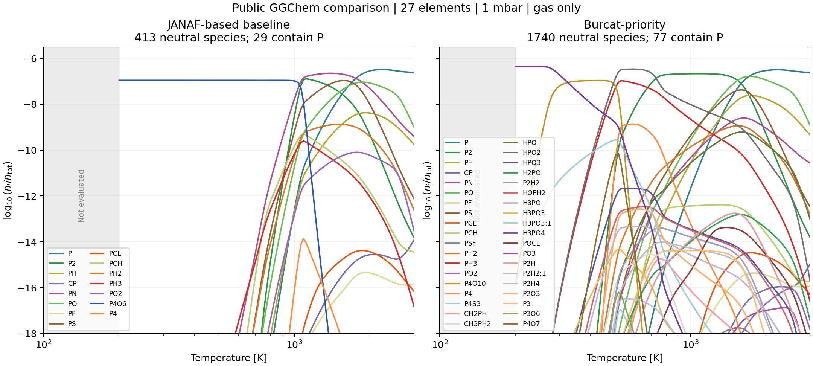
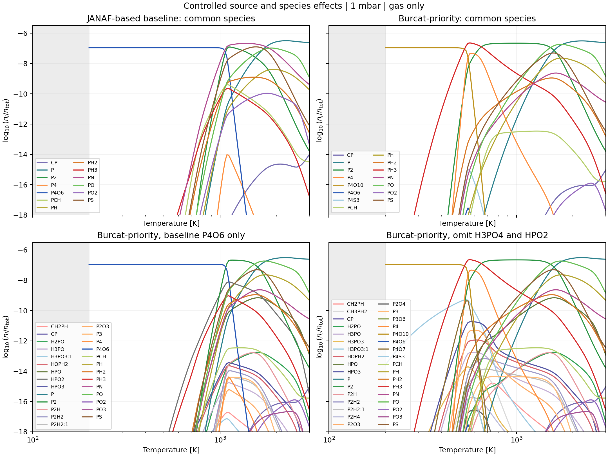
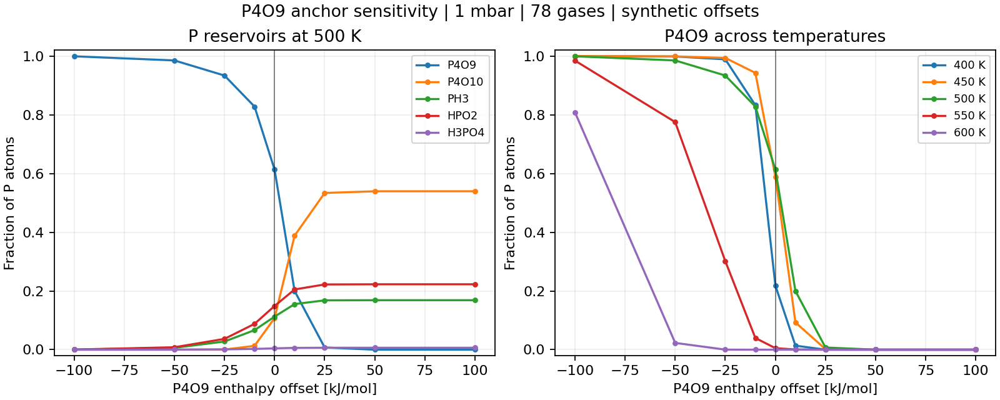

The phosphorus comparison now includes new two-panel calculations in the format of Ohno's slide p3: logarithmic temperature versus `log10(n_i/n_tot)`, at **1 mbar**. The JANAF-based selection concentrates cold phosphorus in P4O6, while Burcat-priority distributes it among H3PO4, P4O10, HPO2 and other molecules. ExoGibbs also evaluates the actual native inputs, and controlled runs separate the P4O6 source effect from the species-list effect.

These are **public-source calculations under declared conditions**, not a curve-by-curve reconstruction of Ohno's unpublished inputs. The original code revision, source selection, abundances and phase settings are unknown. The supplied slide itself is not included in this report.

**Main comparison: 27 elements**



Both panels use public GGChem commit [`65bbb8f9`](https://github.com/pw31/GGchem/tree/65bbb8f9ca3d6c0b4e58cb7dd3862322452d0d4b), all 27 elements in ExoGibbs's pinned Asplund2021 file, neutral gas chemistry, no condensation/rainout, and 121 logarithmic temperature samples from 200 to 3000 K. `n_tot` includes all retained gas particles. The native per-element stoichiometric cap is 16. The gray region below 200 K is not evaluated. The sampled interval does **not** certify every source fit's validity; native `dispol` files omit the original interval metadata.

| Selection | Data files, in increasing priority | Species, including atoms | P-bearing species |
|---|---|---:|---:|
| JANAF-based baseline | BarklemCollet → StockKitzmann_withoutTsuji → WoitkeRefit | 413 | 29 |
| Burcat-priority | Same baseline → full BURCAT | 1740 | 77 |

These labels deliberately describe the effective selections. They are not two pure single-source databases. The baseline P4O6, P4O10, PH3 and PN functions are Woitke NIST refits. The final Burcat file overrides matching records and adds species; 133 molecular records in the 27-element calculation still come from the earlier sources. The final native selection is exported and audited, including GGChem's same-formula/name-resolution rules.

The main contrast in the slide is recovered. At the sample near 1000 K (992.851 K), the baseline puts **95.96% of P atoms into P4O6**, while Burcat-priority puts **96.99% into P2**. At 504.500 K, the Burcat-priority P budget is approximately **50.23% P4O10, 35.92% HPO2, and 13.33% PH3**. These explanatory percentages are P-atom allocations; the plots themselves show molecular number fractions.

**Separate source changes from missing molecules**

For controlled comparisons, we retain H/He/C/N/O/P/S at the same elemental abundances and pressure. Native baseline/Burcat-priority have 91/1156 species in this subset. The entire baseline is contained in the unambiguously matched 91-species common set. Distinct isomers and native records are retained.



| Intervention | Result under the declared 7-element conditions |
|---|---|
| Hold the same 91 species; change the thermochemical functions | The low-temperature reservoir changes from P4O6 to P4O10 even without adding H3PO4/HPO2. |
| Keep all 1156 Burcat-priority species; replace **only P4O6** with the baseline function | P4O6 again takes essentially all P near 500 K and **99.19% at 992.851 K**. The P4O6 source effect survives the additional competitors. |
| Keep Burcat-priority data; remove only H3PO4 and HPO2 | At 200 K, P moves from H3PO4 to P4O10. At 504.500 K, P4O10's P-budget share rises from **63.41% to 94.39%**. |
| Compare that two-gas removal with the common 91-species Burcat case | Across all sampled P species and temperatures, the largest P-budget difference is **0.421 percentage points**. These two gases explain most of the added-species effect in this particular subset. |

The [7-element native comparison](../../documents/_static/ohno_p3_database_comparison.png) uses the same axes and species colors. Extending the background from 7 to 27 elements preserves the qualitative contrast, but changes individual P-budget shares by up to **12.95 percentage points** in the baseline and **23.23 percentage points** in Burcat-priority. Exact background composition therefore matters for quantitative curve matching.

**How this relates to the earlier P4O9 and HCN investigations**

- P4O9 is absent from both native selections. Its earlier 500 K peak came from a separate CEA-augmented research network. It is not a Burcat-priority prediction and should not be inserted into the main comparison without declaring the source change.
- The CEA P4O9 record matches the [original NASA coefficients](https://ntrs.nasa.gov/api/citations/20020085330/downloads/20020085330.pdf), with formation enthalpy -2613.979 kJ/mol at 298.15 K. Its physical uncertainty remains unresolved. In the separate 78-species model, a hypothetical +10 kJ/mol shift reduces its 500 K P share from 61.36% to 19.98%. The offsets below are sensitivity probes, not experimental error bars.
- P4S3 is included in both native selections through the inherited Stock/Kitzmann record. In the 27-element Burcat-priority run its maximum P-budget share is about 1.01e-10, so it is negligible for this sampled setup. The earlier 78-species fixture did not include it.
- Daniel's preliminary HCN files improve the HCN comparison but do not update neutral P records or add H3PO4/HPO2. This remains a separate issue from the P thermochemistry and species coverage.



The source diagnosis is consistent with the large P4O6 enthalpy discrepancy: [JANAF](https://janaf.nist.gov/tables/O-087.html) gives about -2214 kJ/mol, while the inspected [Burcat entry](https://respecth.elte.hu/burcat/BURCAT.THR.txt) selects about -1606 kJ/mol. The current curated neutral-P records inherit FastChem4's Burcat-derived P4O6 choice, but curated's 1500–4000 K domain and missing low-temperature gas species remain separate limitations. No production constants or preset ranges were changed.

**Numerical evidence and remaining uncertainty**

All **484 native GGChem states** (two selections × two element sets × 121 temperatures) pass the declared closure checks. Diagnostic output was added to export final constants and full-precision densities; for all four profiles, standard output is byte-identical to an executable without those diagnostics. The native maximum relative elemental residual is 7.33e-15 and maximum absolute log mass-action residual is 3.40e-9.

All **968 ExoGibbs states** pass: six 7-element profiles plus two 27-element profiles. Independent cold solves are refined once using only their own solution, with the same stopping tolerance; no native solution or adjacent-temperature solution is used as a seed. Maximum relative elemental residual is 4.42e-8, maximum absolute log mass-action residual is 9.10e-12, and the maximum matched-input GGChem difference is **6.69e-8 in natural log mole fraction**, including trace species. The thermochemical constants are shared through the native export, so this is an independent solver comparison, not independent validation of their evaluation or physical accuracy.

The 27-element native comparison and the 7-element controls support the **qualitative database effect**, not a determination of which complete thermochemical source is physically correct. Source uncertainty, omitted phases, ionization, and original temperature-validity metadata remain unresolved. MCEG records numerical support separately from unknown physical applicability.

**Reproduction**

The [report and evidence files](../../reports/phosphorus-20261031/README.md) include the source selections, hashes, computed P abundance curves, scripts and MCEG contract. The artifact commit is based on ExoGibbs `33b2b0962afb05a4a3c06129e2cfaec3e0787dfc`. It contains generated results and our reproduction code; the original slides and third-party thermochemical coefficient tables are not redistributed.

With the artifact branch checked out, the project dependencies and `gfortran`/`make` available:

```bash
mkdir -p results/ohno_p3
curl -fL https://codeload.github.com/pw31/GGchem/zip/65bbb8f9ca3d6c0b4e58cb7dd3862322452d0d4b \
  -o results/ohno_p3/ggchem_upstream.zip
python mceg/reviews/ohno_ggchem_20261031.py --run --check-unmodified
python mceg/reviews/ohno_ggchem_20261031.py --run --extended --check-unmodified
JAX_PLATFORMS=cpu JAX_ENABLE_X64=1 python mceg/reviews/ohno_exogibbs_20261031.py
JAX_PLATFORMS=cpu JAX_ENABLE_X64=1 python mceg/reviews/ohno_exogibbs_20261031.py \
  --native-input results/ohno_p3/native27_cases.json --native-only \
  --output-dir results/ohno_p3/exogibbs27
MPLCONFIGDIR=/tmp/exogibbs-mpl python mceg/reviews/plot_ohno_p3_20261031.py
```

The pinned archive SHA is checked before extraction. Numerical runs can subsequently be repeated offline using that archive. The supplemental P4O9 panel is an archived result of the separate earlier study; the commands above regenerate the new native comparisons and controls.

Validation: **25 related tests passed** (including six tests added for native record parsing, source identity, sampled-input controls and relative paths). MCEG numerical and sensitivity audits each have 5 PASS; physical applicability has 3 PASS and 2 UNKNOWN, with no failures. The isolated report build passes. The repository-wide documentation update is still blocked by the pre-existing ExoEOS contract hash mismatch; this is separate from the calculation results.


Evidence files in this artifact commit:

- [Detailed report](../../documents/mceg/ohno_p3.rst)
- [Calculated P curves, compressed JSON](../../tests/data/validation/ohno_p3/summary.json.gz)
- [Seven-element native manifest](../../tests/data/validation/ohno_p3/native_manifest.json)
- [27-element native manifest](../../tests/data/validation/ohno_p3/native27_manifest.json)
- [MCEG contract](../../mceg/contracts/ohno_p3.yaml)
- [Numerical audit](ohno_numerical_review.json), [sensitivity audit](ohno_sensitivity_review.json), [physical audit](ohno_physical_review.json)
- [Test receipt](targeted_tests.xml)
