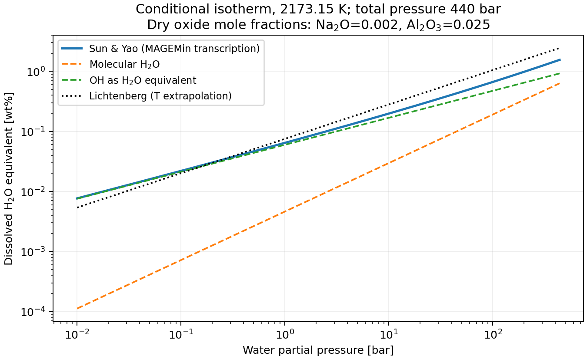

# Conditional Sun–Yao water comparison

`water_curves.png` is a constitutive comparison, not a fit to observations.
Run `JAX_ENABLE_X64=1 python examples/comparisons/compare_sun_yao_water.py
--output results/sun_yao2026` from the repository root to reproduce its CSV
and figure. T=2173.15 K, total P=440 bar, dry oxide mole fractions
Na2O=0.002 and Al2O3=0.025 are fixed illustrative inputs. Water partial
pressure varies from 0.01 to 440 bar. H2/He and finite budgets are absent.

The implementation reference is [MAGEMin_C.jl](https://github.com/ComputationalThermodynamics/MAGEMin_C.jl/blob/47e2d12bfec0f799acf030b285fa3b1e8eb32098/julia/TE_saturation_models.jl),
commit `47e2d12bfec0f799acf030b285fa3b1e8eb32098`, GPL-3.0.
The retrieved source SHA-256 is
`14d80bb0df7b7588a7b1905f284c9f1572620bde912473e66e4544f6fff088de`.
It attributes the water equations and ten coefficients to Eq. 7 / Table 1
of [Sun & Yao (2026)](https://doi.org/10.1016/j.epsl.2026.120115).
The independent scalar tests evaluate that transcription; they are not a
replay of the authors' MATLAB program or experimental data.

On 2026-10-18 the publisher's public API confirmed the title, DOI and
publication date, but returned only metadata. Publisher full-text and
supplement requests returned HTTP 403. The author's public tools page and
GitHub account exposed MAGEC (2024), not an independently downloadable
M2Fluid source or its experiment table. No empirical residual or joint
BSE/H2-rich calibration claim is made. The dataset's marginal T/P envelope
must not be used as a rectangular validity region. No default is changed.
